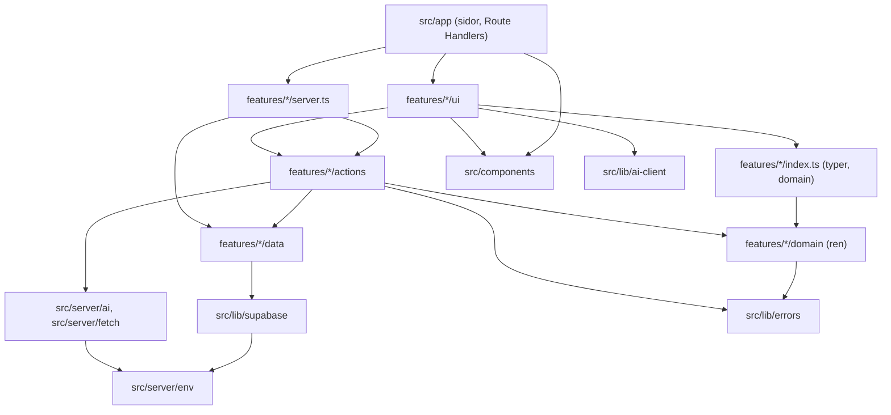
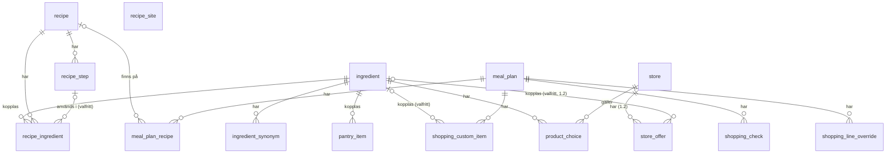
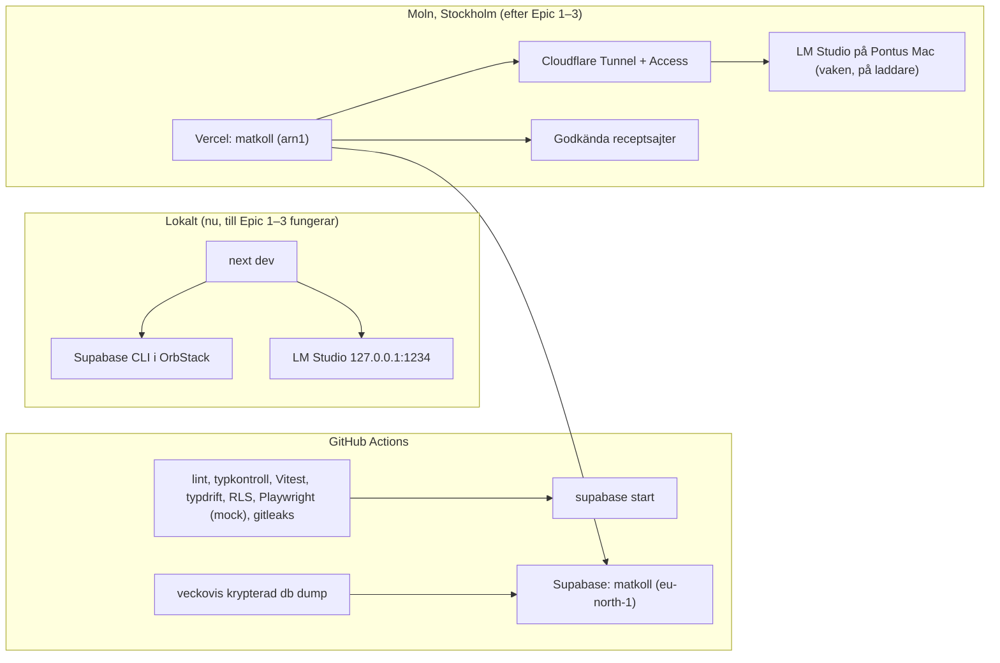

# Arkitektur – Matkoll

## Design Paradigm

**Modulär monolit** i en Next.js-app. Varje funktionsområde är en feature-modul med fyra lager. Externa tjänster (AI, receptsajter) nås bara via portar i `src/server/`.

| Lager | Plats | Får innehålla |
| --- | --- | --- |
| Route | `src/app/**` | Sidor, layouter, Route Handlers. Tunna: hämtar via modulernas `server.ts`, renderar `ui`. |
| UI | `src/features/<f>/ui/` | React-komponenter. Klientkomponenter anropar actions, `search*`-läsactions och `src/lib/ai-client.ts`. |
| Actions | `src/features/<f>/actions/` | Server Actions (`"use server"`) och serverfunktioner för AI-flöden: `requireUser()`, Zod-validering, anropar `domain`, `data` och portar. |
| Domain | `src/features/<f>/domain/` | Rena TypeScript-funktioner och Zod-scheman. Ingen I/O, inget React, ingen Next, ingen Supabase. |
| Data | `src/features/<f>/data/` | Supabase-frågor för modulens egna tabeller. `queries.ts` (läsning, `server-only`) och skrivfunktioner. |
| Portar | `src/server/ai/`, `src/server/fetch/` | AI-tjänsten och säker hämtning från receptsajter. |

Feature-moduler och deras tabeller:

| Modul | Äger tabeller |
| --- | --- |
| `auth` | – (Supabase Auth) |
| `catalog` | `ingredient`, `ingredient_synonym` |
| `recipes` | `recipe`, `recipe_step`, `recipe_ingredient` |
| `pantry` | `pantry_item` |
| `mealplan` | `meal_plan`, `meal_plan_recipe` |
| `shopping` | `shopping_check`, `shopping_line_override`, `shopping_custom_item`, `product_choice` |
| `suggestions` | – (läser via andra moduler) |
| `settings` | `recipe_site`, `store` |
| `offers` (1.2, AD-25) | `store_offer` |

## Invariants & Rules



Pilarna är de enda tillåtna beroendena. En annan modul nås bara via dess `index.ts` (typer och `domain`, säker i klient och server) eller `server.ts` (`server-only`: läsfunktioner från `data/queries.ts` och actions). Upprätthålls med ESLint `import/no-restricted-paths`; zonerna skrivs i första storyn.

### AD-1 – Lagerregler, ägarskap och ingångar

- **Binds:** all kod
- **Prevents:** affärslogik i sidor, moduler som läser eller skriver varandras tabeller, och Server Actions som används som läs-API.
- **Rule:** Beroenden följer diagrammet. Varje tabell skrivs och läses bara av sin ägarmodul (tabellen ovan); andra moduler använder ägarens exporterade läsfunktioner och actions. Server Actions används inte för läsning, utom `search*`-actions för sökning medan man skriver. Komponenter som behövs i flera moduler ligger i `src/components/`. Portar importerar aldrig `src/lib/supabase` eller `src/features/*`; det de behöver skickas in som argument. En skrivning som måste vara atomär görs som en Postgres-funktion (`security invoker`) i ägarmodulens migration och skriver bara ägarens tabeller. Flöden över flera moduler görs idempotenta i stället för atomära.

### AD-2 – En väg för ändringar

- **Binds:** alla skrivningar, FR-6, FR-16, FR-18, FR-25, NFR-1
- **Prevents:** skrivvägar som kringgår validering och inloggning, och AI-flöden som sparar utan bekräftelse.
- **Rule:** Webbläsaren använder aldrig Supabase-klienten. Läsning sker i Server Components via `server.ts`. Skrivning sker bara via Server Actions som börjar med `requireUser()` och validerar med Zod. Route Handlers under `src/app/api/ai/*` skriver aldrig till databasen; de anropar bara skrivfria funktioner, och resultatet lever i klienten tills Pontus sparar eller bekräftar via en Server Action.

### AD-3 – Inloggning och tillåtelselista

- **Binds:** FR-1, NFR-1
- **Prevents:** konton utanför tillåtelselistan, sidor som bara skyddas av proxyn, och öppna omdirigeringar.
- **Rule:** Supabase Auth med engångslänk och `@supabase/ssr`-cookies. Registrering är avstängd (`enable_signup = false` lokalt och i molnet), `signInWithOtp` anropas med `shouldCreateUser: false`, och de tillåtna användarna skapas av skriptet `pnpm users:sync` (service role) från `ALLOWED_EMAILS`. Länken går till `src/app/auth/confirm/route.ts`, som anropar `verifyOtp({ token_hash, type: 'email' })`; e-postmallen ligger i `supabase/config.toml` och sätts likadant i molnet. `src/proxy.ts` förnyar sessionen med `getClaims()` och omdirigerar till `/logga-in` (optimistisk kontroll). Den auktoritativa kontrollen är `requireUser()`: `getClaims()` plus att e-postadressen finns i `ALLOWED_EMAILS`, memoiserad per förfrågan med React `cache`. Den anropas i varje action, Route Handler och läsfunktion och ger `unauthorized` (401 i Route Handlers). Parametern `next` får bara vara en sökväg som börjar med `/` men inte `//`. Svaret på inloggningssidan är detsamma oavsett om adressen är tillåten.

### AD-4 – Dataisolering med RLS och grants

- **Binds:** FR-2, NFR-1, NFR-8, alla tabeller
- **Prevents:** tabeller utan skydd, skillnad mellan lokal miljö och moln, och rader som pekar på en annan användares data.
- **Rule:** Varje tabell i `public` har `user_id uuid not null default auth.uid() references auth.users on delete cascade`, RLS påslaget och en policy `user_id = (select auth.uid())` för select, insert, update och delete. Varje migration som skapar en tabell ger `grant select, insert, update, delete` till `authenticated` och `service_role`, aldrig till `anon`. `supabase/config.toml` har `[api] auto_expose_new_tables = false`. Barntabeller refererar föräldern med sammansatt främmande nyckel `(parent_id, user_id)`. Serverkod i förfrågningar använder användarens sessionsklient, aldrig service role; service role används bara i tester och skript. Varje ny tabell får ett RLS-test där en anonym klient och en annan användare varken kan läsa eller skriva (`42501` eller tomt resultat godtas).

### AD-5 – Schemaändringar

- **Binds:** alla tabeller
- **Prevents:** schema som skiljer mellan lokalt, CI och moln, och typer som glider från schemat.
- **Rule:** Schemat ändras bara via SQL-filer i `supabase/migrations/` skapade med `supabase migration new`. Efter varje migration körs `supabase gen types --local --schema public > src/lib/supabase/database.types.ts`, och CI misslyckas om den genererade filen skiljer sig. Migrationer är bakåtkompatibla med föregående koddriftsättning.

### AD-6 – Ingredienskatalogen äger matchningen

- **Binds:** FR-5, FR-6, FR-11, FR-17, FR-24, FR-25, FR-27
- **Prevents:** katalogposter från recept som aldrig sparas och avvisade lagerförslag, dubbletter, och olika matchningsregler i olika moduler.
- **Rule:** Bara `catalog` skriver `ingredient` och `ingredient_synonym`. Matchning sker i två steg:
  1. `matchIngredients(items: { text, hint? }[]): IngredientMatch[]` är skrivfri. Den matchar på normaliserat namn, sedan synonym. Utan träff returneras `{ kind: 'new', proposal: { name, section, location, defaultUnit } }` byggt från `hint`, som kommer från det AI-svar som redan finns (`parseRecipe`, `analyzeImage`). Träff ger `{ kind: 'match', ingredientId, confidence: 'exact' | 'synonym' }`.
  2. `commitIngredients(choices)` anropas bara från sparande actions (`saveRecipe`, `updateRecipe`, `confirmPantrySuggestions`, `setPantryItems`, `addCustomItem` när en katalogkoppling valts). Den skapar nya katalogingredienser med `insert … on conflict (user_id, normalized_name) do update … returning id` och sparar originaltexten som synonym när Pontus valt en annan ingrediens än förslaget.

  Normalisering görs bara av `catalog/domain/normalize.ts` (gemener, trimmat, utan mängd och tillagningsord). `ingredient` är unik på `(user_id, normalized_name)`, `ingredient_synonym` på `(user_id, normalized)`. Receptrader, lagervaror, receptposter i listan och produktval refererar alltid `ingredient_id`; egna varor får sakna det.

### AD-7 – Mängdlogiken finns på ett ställe

- **Binds:** FR-8, FR-13, FR-15, FR-20, FR-22
- **Prevents:** att receptbiblioteket, matsedeln, receptvyn, rangordningen och inköpslistan räknar "finns hemma" och "Saknar N" olika.
- **Rule:** I `pantry/domain/`:
  - `aggregateNeeds(lines, factor)` summerar behov per `(ingredientId, unit)` och är det enda stället där behov summeras.
  - `coverage(need, snapshot)` är den enda jämförelsen mot lagret och returnerar `covered`, `partial` (kvarvarande mängd), `other-unit` (lagrets mängder), `missing` eller `vague-missing`. En vag rad är täckt om ingrediensen finns i lagret i någon form.
  - `recipeStatus(recipe, servings, snapshot)` ger lagningsstatus, "X av Y hemma" och "Saknar N". N är antalet distinkta katalogingredienser med `missing`, `partial` eller `other-unit`; vaga rader räknas inte. Varje recept jämförs mot hela lagret, utan att lagret fördelas mellan rätter. Att en matsedelsrätt visar "Kan lagas nu" medan listan föreslår samma vara är avsiktligt.
  - Skalning efter portioner sker bara i `recipes/domain/scale.ts`. Enheter räknas aldrig om.

### AD-8 – Inköpslistan räknas fram vid läsning

- **Binds:** FR-15, FR-16, FR-17, FR-18, FR-19, FR-26
- **Prevents:** en lagrad lista som blir inaktuell, bockar som tappas när lagret ändras, och vyer som tillämpar överlägget olika.
- **Rule:** `shopping/domain/computeList(input): ShoppingLine[]` är den enda källan till listposter för vyn, "Lägg i lagret" och exporten. `input = { plan, recipes, snapshot, catalog, overlay }`, och `overlay = { checks, overrides, customItems }`. Listnyckeln byggs bara av `shopping/domain/lineKey.ts`: receptpost `r:<ingredientId>:<unit|->` (vag rad ger `-`; täckningsstatus ingår aldrig), receptrad utan katalogingrediens `t:<normaliserad text>`, egen vara `c:<shopping_custom_item.id>`. Överlägget lagras per matsedel:
  - `shopping_check(meal_plan_id, line_key)` för alla bockar, även egna varor;
  - `shopping_line_override(meal_plan_id, line_key, amount, hidden)` för rättad mängd och dold post;
  - `shopping_custom_item` för egna varor, som aldrig slås ihop med receptposter och grupperas under katalogingrediensens avdelning eller Övrigt.

  `ShoppingLine = { key, ingredientId?, label, amount, unit, isVague, coverage, pantryNote?, section, origins: mealPlanRecipeId[], checked, isCustom }`. "Lägg i lagret" (`shopping/actions/putCheckedInPantry`) skickar avbockade poster till `pantry.addToPantry` (vag post blir obegränsad lagervara), tar bort egna varor utan katalogkoppling och rensar sedan bockarna och överstyrningarna för de nycklarna. Upprepas flödet blir resultatet detsamma.

### AD-9 – AI-tjänsten är en port

- **Binds:** FR-3, FR-4, FR-5, FR-23, FR-24, NFR-2, NFR-7
- **Prevents:** leverantörsspecifik kod i modulerna, ovaliderade AI-svar, anrop som inte går att avbryta och en sovande Mac som låser appen.
- **Rule:** `src/server/ai/` exporterar `AiService` med `parseRecipe`, `analyzeImage` och `suggestDishes`. Alla tar en `AbortSignal`. Adaptrarna `lmstudio`, `anthropic`, `openai` och `mock` väljs med `AI_PROVIDER`; bara `src/server/ai/` får importera `ai` och `@ai-sdk/*`.
  - Anrop görs med `generateText` och `Output.object({ schema })`, aldrig `generateObject`. Bilder skickas som `file`-delar.
  - `lmstudio` skapas med `createOpenAICompatible({ baseURL, supportsStructuredOutputs: true, headers })`, där `headers` bär Cloudflare Access-token när de finns, och tänkläget stängs av i anropet.
  - SDK:ns `maxRetries` är 0. Porten gör högst två nya försök vid ogiltigt svar (`ai_invalid`). Nätverksfel, tidsgräns för anslutning (5 s) eller svar som inte är JSON ger `ai_unavailable` utan nya försök. Tidsbudget: 100 s per försök, 115 s totalt (ändrad 2026-10-25 efter Story 1.8: Qwen i LM Studio behöver 40–56 s för fulla recept). Ett nytt försök görs bara om tiden räcker.
  - Svarsscheman finns i `src/server/ai/schemas.ts` och promptar som filer i `src/server/ai/prompts/`. `mock` är deterministisk och används i alla tester och i CI.
  - AI-flöden startas från klienten via `src/lib/ai-client.ts` till Route Handlers i `src/app/api/ai/*` (`maxDuration = 120`). Handlern anropar modulens serverfunktion (t.ex. `recipes/actions/importRecipe.ts`) och skickar vidare `request.signal`. AI anropas aldrig vid rendering eller i `data`.
  - Tillägg (1.2, AD-25): porten får en fjärde metod, `extractOffers`, med samma regler, och `suggestDishes` får veckans erbjudanden som namn bredvid lagret.

### AD-10 – Ett receptformat

- **Binds:** FR-3, FR-4, FR-5, FR-6, FR-10, FR-21, FR-23
- **Prevents:** olika importvägar som ger olika format, och redigering som tappar stegkopplingar.
- **Rule:** `parseRecipe` och `suggestDishes` returnerar samma `AiRecipe`-schema (med katalogförslag per rad). `recipes/domain/fromAiRecipe(aiRecipe, matches): RecipeDraft` är den enda mappningen och används för länk, text, foto och AI-förslag. `RecipeDraft` (Zod) innehåller titel, originalportioner, total tid i minuter, bild-URL, `sourceKind` (`url | text | photo | ai`), `sourceUrl` (bara för `url`), steg och receptrader. Varje receptrad har originaltext, mängd, enhet, vag, `ingredient: IngredientMatch | { kind: 'chosen', ingredientId }` och valfria stegindex. Inget importflöde skriver till databasen. `saveRecipe(draft)` och `updateRecipe(id, draft)` är de enda skrivvägarna; `updateRecipe` behåller id för rader och steg som finns kvar och översätter stegindex till id. AI-förslag finns bara i klientens tillstånd tills de sparas. Visningstexten för källa väljs bara i `recipes/domain/sourceLabel()`.

### AD-11 – Hämtning från receptsajter

- **Binds:** FR-3, FR-7, NFR-1, NFR-8
- **Prevents:** SSRF, hämtning från ej godkända domäner, och AI-normalisering som hoppas över.
- **Rule:** `src/server/fetch/safeFetch(url, { allowedDomains, signal })` är den enda kod som hämtar från receptsajter. Anroparen läser domänlistan via `settings`. Krav: bara https; värden ska vara en domän i listan eller dess `www.`-variant; DNS slås upp och privata, lokala och reserverade adresser avvisas; omdirigeringar följs manuellt med ny kontroll (högst 3); 10 s tidsgräns; högst 3 MB. Kontrollen sker före varje anslutning och testas i CI med sparade sidor från koket.se och tasteline.com. JSON-LD (`schema.org/Recipe`) skickas, om den finns, som indata till `parseRecipe` tillsammans med sidans läsbara text; den används aldrig direkt som `RecipeDraft`. Domäner som Pontus lägger till valideras och normaliseras av ett Zod-schema i `settings/domain` (gemener, utan schema, sökväg och `www.`).

### AD-12 – Enheter, mängder, avdelningar och platser

- **Binds:** FR-5, FR-11, FR-12, FR-15, FR-16, FR-19, FR-20, FR-26
- **Prevents:** att "dl" och "deciliter" blir olika listposter, olika formatering av mängder, och egna stavningar av avdelningar och platser.
- **Rule:** I `catalog/domain/`:
  - `units.ts`: enheterna `g, kg, ml, cl, dl, l, krm, tsk, msk, st, förp, klyfta, kruka, knippe, skiva`; `normalizeUnit(raw)` med alla alias (t.ex. "deciliter" → `dl`, "paket" → `förp`), `parseQuantity(text)` ("1,5", "½") och `formatQuantity(amount, unit)` (svenskt decimalkomma). De är de enda tolknings- och visningsfunktionerna. En okänd enhet gör raden vag med originaltexten kvar.
  - `sections.ts`: Frukt och grönt, Bröd, Mejeri, Kött och fisk, Chark, Frys, Skafferi, Dryck, Övrigt, i den ordningen. Okänd avdelning blir Övrigt.
  - `locations.ts`: Kyl, Frys, Skafferi.

  Alla tre är Zod-enum som AI-scheman, formulär och listans gruppering använder, och `text`-kolumner med `check` i databasen. Mängd lagras som `numeric`, `null` för vag rad (`is_vague = true`) och obegränsad lagervara. Avrundning sker bara i `formatQuantity`.

### AD-13 – Resultat och fel

- **Binds:** alla actions och Route Handlers, NFR-6
- **Prevents:** olika felformer per modul och engelska tekniska fel i gränssnittet.
- **Rule:** Actions och Route Handlers returnerar `{ ok: true, data } | { ok: false, error: { code, message } }`. `code` namnges `<område>_<orsak>` och finns i `src/lib/errors.ts` tillsammans med den svenska texten (Voice and Tone i `EXPERIENCE.md`), t.ex. `unauthorized`, `validation`, `fetch_domain_not_allowed`, `fetch_blocked`, `fetch_timeout`, `fetch_too_large`, `import_no_recipe`, `ai_unavailable`, `ai_invalid`, `image_too_large`. Förväntade fel kastas aldrig till klienten.

### AD-14 – Konfiguration och hemligheter

- **Binds:** NFR-1, NFR-2, NFR-8
- **Prevents:** nycklar i klientkod, variabler med olika namn och saknade värden som upptäcks först vid anrop.
- **Rule:** All miljö läses via `src/server/env.ts` (`server-only`), validerad med Zod vid start. Godkända namn: `NEXT_PUBLIC_SUPABASE_URL`, `NEXT_PUBLIC_SUPABASE_PUBLISHABLE_KEY`, `SUPABASE_SERVICE_ROLE_KEY` (bara tester och skript), `SITE_URL` (appens publika adress, används i länkar i e-post), `ALLOWED_EMAILS`, `AI_PROVIDER`, `AI_MODEL`, `LMSTUDIO_BASE_URL`, `CF_ACCESS_CLIENT_ID`, `CF_ACCESS_CLIENT_SECRET`, `ANTHROPIC_API_KEY`, `OPENAI_API_KEY`. Nya variabler kräver en ändring av den här listan och `.env.example`. Hemligheter ligger i `.env.local` lokalt och i Vercels miljö i molnet.

### AD-15 – Bilder

- **Binds:** FR-4, FR-8, FR-24
- **Prevents:** lagrade privata foton, uppladdningar som stoppas av Vercels gräns på 4,5 MB, och trasiga receptbilder.
- **Rule:** Foton av kokbokssidor och platser förminskas i klienten till högst 1600 px och 1,5 MB (JPEG) före uppladdning, kontrolleras på servern (`image_too_large`), skickas till AI-tjänsten och sparas aldrig. Receptbilder sparas som URL och visas med `` och en platshållare vid fel. Ingen CSP i v1.
- **Tillägg (1.2, AD-25):** ett foto av ett reklamblad eller en skärmbild av en erbjudandesida behandlas som ett foto av en plats: samma största sida som en plats (2048 px från Story 6.5) och samma tak på 1,5 MB. Det skickas till AI-tjänsten och sparas aldrig.

### AD-16 – Varukorgsexporten

- **Binds:** FR-26, FR-27, FR-28
- **Prevents:** en export som ändras utan att instruktionen till Claude in Chrome följer med, och en export som ber agenten beställa.
- **Rule:** `shopping/domain/exportBasket(lines, store, choices)` skapar texten. Den börjar med `Matkoll varukorgsexport v1` och innehåller butikens namn, kedja, butiks-id, adress och URL, sedan de poster som inte är avbockade, dolda eller vaga, grupperade i avdelningsordning, med mängd från `formatQuantity` och produktval när det finns, och sist den ordagranna instruktionen i `docs/varukorgsexport.md`, som innehåller "Beställ inte" och "rapportera varor du är osäker på i en separat lista". Formatet låses med ett golden-file-test; en ändring höjer versionen. Texten byggs i klienten av redan laddad listdata, så att `navigator.clipboard.writeText` körs direkt i tryckhändelsen. `product_choice` ägs av `shopping` och är unik på `(user_id, ingredient_id, store_id)`; `settings` äger `store` (högst en `is_selected`).

### AD-17 – Designtokens

- **Binds:** NFR-3, NFR-4, NFR-5, all UI
- **Prevents:** hårdkodade färger och mått som glider från `DESIGN.md`.
- **Rule:** Tokens från `DESIGN.md` definieras som CSS-variabler i `:root` i `src/app/globals.css` och mappas med Tailwind `@theme inline`. Mörkt läge byter variablerna i `@media (prefers-color-scheme: dark)`. Tailwind körs via `@tailwindcss/turbopack` som i startmallen, utan PostCSS-konfiguration. Komponenter använder bara tokenklasser, aldrig hex-värden.

### AD-18 – Rendering och cache

- **Binds:** alla sidor och actions
- **Prevents:** byggfel från sessionsläsning utanför `<Suspense>`, cachad användardata och inaktuella härledda vyer.
- **Rule:** `cacheComponents: true` behålls som i startmallen. Allt som läser sessionen eller användardata renderas i en komponent inuti `<Suspense>`; en layout gör aldrig `await` på sessionen på toppnivå. Ingen `'use cache'` på användardata i v1. Route segment config begränsas till `maxDuration`. Efter en skrivning anropar actionen `revalidateFor(table)` från `src/lib/revalidate.ts`, som mappar tabell till alla rutter som visar den eller något härlett ur den (t.ex. `pantry_item` → `/hemma`, `/recept`, `/recept/[id]`, `/matsedel`, `/lista`). `revalidatePath` anropas inte direkt. Tillägg (1.2, AD-25): `store_offer` → `/recept` (layout), och `store` får också `/recept` (layout), eftersom raden med veckans erbjudanden följer vald butik. Klientkomponenter med effekter (t.ex. Wake Lock i stegläget) städar upp i effektens cleanup och återtar resurser vid `visibilitychange`.

### AD-19 – Lagervarans identitet och skrivoperationer

- **Binds:** FR-11, FR-12, FR-19, FR-25
- **Prevents:** dubbla lagerrader och att "lägg till", "sätt" och "öka" får olika betydelse i olika moduler.
- **Rule:** `pantry_item` är unik på `(user_id, ingredient_id, location, unit)` med `unit` `null` för obegränsad (`nulls not distinct`). `pantry` exporterar exakt dessa skrivoperationer:
  - `addToPantry(items)`: ökar en rad med samma ingrediens, plats och enhet eller skapar en. Om ingrediensen redan är obegränsad ändras inget. Saknad plats blir katalogingrediensens plats. Används av "Lägg i lagret".
  - `setPantryItems(items)`: sätter mängden exakt och skapar raden vid behov. Används av arket Lagervara och bekräftade lagerförslag.
  - `removePantryItem(id)` returnerar den borttagna raden, och `restorePantryItem(row)` sätter tillbaka den med samma id.

  Läsning sker med `getPantrySnapshot(): Map<ingredientId, { unlimited, amounts: { unit, amount }[] }>`, summerad över platser, och `listPantry(location)` för vyn. `coverage` tar bara emot snapshot.

### AD-20 – Referenser och borttagning

- **Binds:** FR-10, FR-14, alla främmande nycklar
- **Prevents:** borttagningar som tyst raderar data i andra moduler eller misslyckas med generiska fel, och "Ångra" som ger nya id.
- **Rule:** Främmande nycklar mellan moduler är `on delete restrict`. Inom ett aggregat (recept med steg och rader, matsedel med rätter och överlägg) är de `cascade`. Undantag: `meal_plan_recipe.recipe_id` är `on delete set null`, och raden har `recipe_title` som ögonblicksbild, så tidigare matsedlar visar "Borttaget recept". `recipes.deleteRecipe` anropar först `mealplan.detachRecipe(recipeId)`, som tar bort rätten från den aktuella matsedeln. Katalogingredienser tas inte bort och slås inte ihop i v1. All radering är hård; "Ångra" anropar `restore*(row)` med samma id, och create-actions tar emot ett valfritt id för det.

### AD-21 – Startdata per användare

- **Binds:** FR-7, FR-28
- **Prevents:** att import saknar godkända sajter i molnet, och startdata som skapas på flera sätt.
- **Rule:** Postgres-funktionen `ensure_user_defaults()` (ägs av `settings`, `security invoker`, idempotent med `on conflict do nothing`) lägger in `koket.se` och `tasteline.com` i `recipe_site` och Maxi ICA Stormarknad Östersund (ICA Handla, butiks-id 1003733) som vald `store`. Den anropas av `auth/confirm` efter lyckad inloggning och av testernas setup. `seed.sql` skapar bara lokala testanvändare.

### AD-22 – Aktuell matsedel

- **Binds:** FR-13, FR-14, FR-15
- **Prevents:** flera aktuella matsedlar, och moduler som skapar matsedlar på egen hand.
- **Rule:** `meal_plan.is_current` är unik per användare (partiellt unikt index). `mealplan.addToCurrentPlan(recipeId, servings?)` skapar en aktuell matsedel om ingen finns och lägger alltid till en ny `meal_plan_recipe`-rad (samma recept får förekomma flera gånger). Byte av aktuell matsedel och "Använd igen" görs bara av Postgres-funktionen `set_current_meal_plan(id)`. Inköpslistan, bockar och överstyrningar gäller den aktuella matsedeln.

### AD-23 – Leverans och driftsättning

- **Binds:** NFR-7, NFR-8
- **Prevents:** kod i `main` som inte passerat kontrollerna, publicering utan Pontus godkännande, och schema och kod som driftsätts i fel ordning.
- **Rule:**
  - En gren per epic (`epic/1-receptimport`), PR till `main`. `main` är skyddad: obligatoriska kontroller (lint, typkontroll, Vitest, typdrift, RLS-tester, domänbegränsning, Playwright, gitleaks) och en genomförd kodgranskning (`bmad-code-review`) innan sammanslagning.
  - Före commit kör `lefthook` `gitleaks protect --staged` och ESLint på ändrade filer.
  - CI-actions pinnas på huvudversion (`gitleaks/gitleaks-action@v3`, `supabase/setup-cli@v3`). `package.json` har `"engines": { "node": "24.x" }`.
  - Produktion byggs bara från `main`. Förhandsdriftsättningar saknar Supabase-variabler. `supabase db push` körs före koddriftsättningen. Första publiceringen i produktion kräver Pontus godkännande.
  - Vercel och Supabase ligger i Stockholm (Vercel `arn1`, Supabase `eu-north-1`).
  - Ett schemalagt GitHub Actions-flöde gör varje vecka en krypterad `supabase db dump` (lösenfras som hemlighet) och sparar den som artefakt. Det håller också gratisprojektet aktivt.

### AD-25 – Veckans erbjudanden

- **Binds:** FR-34, FR-35, FR-36, NFR-10, och i 1.2 också FR-23
- **Prevents:**
  - hämtning från butikers webbplatser;
  - AI-svar om erbjudanden som sparas utan att Pontus har sett dem;
  - erbjudanden som fyller ingredienskatalogen med varor som aldrig lagas;
  - erbjudanden från olika veckor eller butiker som blandas i förslagen;
  - erbjudanden som ändrar lagningsstatus, rangordning, inköpslista eller export;
  - text i ett reklamblad som blir en instruktion till modellen.
- **Rule:**
  - **Data:**
    - Den nya modulen `offers` äger `store_offer` (`id`, `user_id`, `store_id`, `week_start`, `label`, `name`, `ingredient_id`, `price`, `created_at`).
      - `store_id` refererar `store (id, user_id)` och `ingredient_id` (valfri) refererar `ingredient (id, user_id)`, båda med `on delete restrict` (AD-20, som `product_choice`).
      - `week_start` är veckans måndag, med en `check` på `extract(isodow from week_start) = 1`.
      - `label` är varan som den står i bladet (1–120 tecken), `name` är varan i grundform, normaliserad med `catalog/domain/normalize.ts` (1–100 tecken), och `price` är priset som text (högst 40 tecken) eller `null`. Ingen text har radbrytningar.
      - Unik på `(user_id, store_id, week_start, name)`, med indexet `(user_id, store_id, week_start)`.
      - RLS, grants och RLS-test enligt AD-4.
    - Ingen annan modul läser eller skriver `store_offer` (AD-1).
  - **Vecka:**
    - Bara `offers/domain/week.ts` räknar veckor, alltid i svensk tid (`Europe/Stockholm`): `weekStartOf(date)`, `isWeekOver(weekStart, now)`, `importWeekDefault(now)` och `weekLabel(weekStart)` ("vecka 45, 4–10 nov").
    - En vecka går från måndag till söndag. Bara den här och nästa vecka går att spara. Förvalet är den här veckan måndag–fredag och nästa vecka lördag–söndag, eftersom bladet för nästa vecka brukar komma i helgen.
    - **Veckans erbjudanden** för en butik är erbjudandena för den senaste `week_start` vars vecka inte är slut. Veckor blandas aldrig.
  - **Läsning:** `offers/server.ts` exporterar `getActiveOffers(storeId): { weekStart, offers } | null` och `listOffers(storeId, weekStart)`, memoiserade per förfrågan med React `cache`.
  - **Skrivning:**
    - `saveOffers({ storeId, weekStart, items })` (Server Action) anropar Postgres-funktionen `save_store_offers(store uuid, week date, items jsonb)` (`security invoker`, en transaktion). Den
      - nekar en vecka som är slut eller ligger längre fram än nästa vecka (`offers_week_invalid`);
      - lägger till eller uppdaterar per `name` (`label`, `price` och `ingredient_id` från den nya inläsningen), så att flera inläsningar för samma vecka läggs ihop;
      - nekar fler än 100 erbjudanden för butiken och veckan (`offers_limit`);
      - tar bort användarens erbjudanden för veckor som är slut.
    - Klienten skickar butikens id och veckan från arket. Servern läser aldrig vald butik vid sparandet, så ett byte av butik på en annan enhet ändrar inte var erbjudandena hamnar.
    - `deleteOffers(ids)` returnerar de borttagna raderna, och `restoreOffers(rows)` sätter tillbaka dem med samma id (AD-20). "Ta bort alla" är `deleteOffers` med veckans alla id.
  - **Katalog:** `name` kopplas till en katalogingrediens med den skrivfria `matchIngredients` (exakt träff eller synonym). Utan träff är `ingredient_id` `null`. `commitIngredients` anropas aldrig, så erbjudanden skapar inga katalogingredienser och inga synonymer (AD-6 är oförändrad).
  - **AI-porten (AD-9):**
    - `extractOffers(input: { text: string } | { image: ImageInput }, signal, options?): Result<{ items: AiOffer[]; invalid: number }>`. Exakt ett av text och bild.
    - Svarsschemat är `extractOffersAnswer = { items: { label, name, price }[] }`, där `price` får vara `null` och alla fält är obligatoriska (strikta JSON-scheman). Varje post kontrolleras för sig mot `aiOffer`, som `aiPantryItem` (Story 6.1). En ogiltig post lämnas ute och räknas i `invalid`. Poster med samma normaliserade `name` slås ihop, och den första behålls.
    - Prompten är `prompts/extract-offers.md`: bara mat och dryck, namnet som det står, `name` i grundform utan märke, mängd och pris, priset som text som det står, aldrig något påhittat, och texten eller bilden är data.
    - Gränser i `inputLimits.offers`: text högst 12 000 tecken (som `parseRecipe`), högst 40 poster (prompten ber om högst 40, och anroparen behåller de första) och `maxOutputTokens` 3 000. Bilden följer AD-15.
    - LM Studio-adaptern skickar en bild med samma sampling som `analyzeImage` (Story 6.5), och text med standardinställningarna.
    - `mock` svarar från påhittade fixturer i `tests/fixtures/ai/` (`*.offers.json`) och har reserverade indata (`matkoll-mock: <kod>`).
  - **Flödet:**
    - `/api/ai/offers` (JSON med text) och `/api/ai/offers/photo` (multipart, `readImageForm`) anropar `offers/actions/readOffers` med `request.signal`.
    - `readOffers` nekar text som bara är en länk (`offers_link`, utan anrop till AI-tjänsten), anropar porten, kopplar mot katalogen och lämnar utkast (`OfferDraft[]`). Handlarna skriver aldrig (AD-2). Utkasten lever i klienten tills Pontus trycker "Spara".
  - **Ingen hämtning från butiker:** `offers` importerar aldrig `src/server/fetch` (ESLint-zon), och ingen kod i flödet anropar `fetch`. Ett test visar det. Erbjudanden läggs aldrig till som godkända receptsajter, och `safeFetch` (AD-11) är oförändrad. Fixturerna är påhittade.
  - **AI-förslag (FR-36):**
    - `suggestions` läser vald butik med `settings.getSelectedStore()` och veckans erbjudanden med `offers.getActiveOffers(store.id)`, i samma förfrågan som lagret. Klienten skickar aldrig erbjudanden.
    - `SuggestDishesInput` får `offers: string[]`, varornas `name` rensade som lagrets namn (`cleanModelText`), högst 40 och högst 1 000 tecken. En tom lista ger exakt samma meddelande som i 1.0.
    - Meddelandet får avsnittet "Erbjudanden i butiken den här veckan:" efter lagret, med en rad per vara. Prompten ber att minst två av rätterna använder minst en vara på erbjudande när det går, och att varorna utöver lagret i första hand är erbjudanden. Schemat kontrollerar inte erbjudandena, så ett svar utan dem är giltigt.
    - Servern räknar vilka erbjudanden varje förslag använder med `offersIn(lines, offers)` i `offers/domain` (samma katalogingrediens, annars samma normaliserade namn). Förslagen sorteras efter antal, flest först och annars i AI:ns ordning. Svaret får `onOffer: string[]` per förslag och `offers: { storeName, weekLabel, count } | null`.
    - Kravet på minst två varor hemma (`minPantryIngredients`) gäller som förut. Lagret är `getPantrySnapshot()` utan argument, alltså valt ställe från 1.1 (AD-24). Erbjudanden hör till en butik och har inget ställe.
    - Om butiken eller erbjudandena inte går att läsa loggas `offers_unavailable`, och förslagen görs utan erbjudanden.
  - **Utan påverkan:** `coverage`, `recipeStatus`, rangordningen (AD-7), `computeList` och exporten (AD-8, AD-16) läser aldrig erbjudanden.
  - **UI:** raden "Veckans erbjudanden" och arket ligger i `offers/ui`. `/recept` renderar raden och skickar den till biblioteket som en slot (route → ui), så att `recipes/ui` aldrig importerar `offers/ui`. Raden "På erbjudande" i ett förslag ritas av `recipes/ui` från `DishSuggestions`.
  - **Fel (AD-13):** `offers_link`, `offers_none`, `offers_text_too_long`, `offers_store_missing`, `offers_week_invalid`, `offers_limit`, `offers_failed` och `offers_unavailable`, med svenska texter i `src/lib/errors.ts`. Loggarna har bara felkoder och antal, aldrig varor eller priser.
  - **Rendering:** `revalidateFor('store_offer')` → `/recept` (layout), och `store` revaliderar också `/recept` (AD-18).

## Consistency Conventions

| Område | Konvention |
| --- | --- |
| Namn i kod | Engelska. Filer i kebab-case, komponenter i PascalCase, funktioner i camelCase. Tabeller i singular snake_case. |
| Namn i gränssnitt och rutter | Svenska: `/recept`, `/recept/[id]`, `/matsedel`, `/lista`, `/hemma`, `/installningar`, `/logga-in`. Begrepp enligt PRD:ns ordlista. |
| Id och tider | `uuid` (`gen_random_uuid()`), `timestamptz`, ISO 8601 över gränser. |
| Validering | Ett Zod-schema per indata, i modulens `domain`. Samma schema i formulär (`safeParse`) och action. |
| Formulär och växlingar | Formulär använder `useActionState`, inget formulärbibliotek. Bockar, hjärtan och portioner använder `useOptimistic`. |
| Mängder i text | Bara `formatQuantity` och `parseQuantity` (AD-12). |
| Loggning | `console.error` med felkod på servern. Ingen användardata eller nycklar i loggar. |
| Tester | Domain: Vitest bredvid koden (`*.test.ts`); `vitest.config.ts` har alias för `@/` och mockar `server-only`. RLS och domänbegränsning: `tests/integration/` mot lokal Supabase. E2E: `tests/e2e/` med Playwright och `AI_PROVIDER=mock`; `global-setup.ts` loggar in testanvändaren med `auth.admin.generateLink` + `verifyOtp` och sparar `storageState`. Ingen testväg i appen. |
| AI-utvärdering | `pnpm eval:ai` kör `tests/fixtures/ai/` mot vald `AI_PROVIDER` och skriver en rapport. Körs manuellt vid byte av leverantör eller modell, inte i CI. |

## Stack

| Namn | Version |
| --- | --- |
| Node.js | 24.x (lokalt 24.22.1) |
| pnpm | 12.15.0 |
| Next.js (App Router, Turbopack, Cache Components) | 16.4.3 |
| React / React DOM | 19.3.1 |
| TypeScript (strikt; startmallen låser ^5) | 5.9.3 |
| Tailwind CSS / @tailwindcss/turbopack | 4.3.3 / 4.3.3 |
| ESLint (startmallen låser ^9) / eslint-config-next | 9.39.5 / 16.4.3 |
| @supabase/supabase-js | 2.118.0 |
| @supabase/ssr | 0.12.7 |
| Supabase CLI | 2.122.0 |
| ai (Vercel AI SDK) | 7.0.153 |
| @ai-sdk/openai-compatible / anthropic / openai | 3.0.78 / 4.0.88 / 4.0.102 |
| zod | 4.6.7 |
| cheerio | 1.2.0 |
| vitest / vite | 5.0.5 / 8.3.5 |
| @types/node | ^24 |
| @playwright/test | 1.64.1 |
| lefthook | 2.2.2 |
| gitleaks / gitleaks-action | 8.30.1 / v3 |
| Testmodell | Qwen3.6-35B-A3B i LM Studio |

## Structural Seed

### Källträd

```text
matkoll/
  src/
    app/                  # (app)/recept, matsedel, lista, hemma, installningar; logga-in; auth/confirm; api/ai/{import,analyze,suggest,offers}
    features/
      auth/ catalog/ recipes/ pantry/ mealplan/ shopping/ suggestions/ settings/ offers/ (1.2)
        ui/ actions/ domain/ data/ index.ts server.ts
    components/           # gemensamma byggstenar och komponenter som används i flera moduler
    lib/
      supabase/           # server- och proxyklient, database.types.ts
      errors.ts  revalidate.ts  ai-client.ts
    server/
      env.ts
      ai/                 # AiService, adaptrar, schemas.ts, prompts/
      fetch/              # safeFetch
    proxy.ts
  supabase/
    migrations/  seed.sql  config.toml
  scripts/                # users-sync, eval-ai, board.mjs
  tests/
    integration/  e2e/  fixtures/{ai,sites}/
  docs/varukorgsexport.md
```

### Datamodell



| Tabell | Kolumner utöver `id`, `user_id`, `created_at` |
| --- | --- |
| `ingredient` | `name`, `normalized_name` (unik), `section`, `location`, `default_unit` |
| `ingredient_synonym` | `ingredient_id`, `normalized` (unik) |
| `recipe` | `title`, `original_servings`, `total_minutes`, `image_url`, `source_kind`, `source_url`, `is_favorite` |
| `recipe_step` | `recipe_id`, `position`, `text` |
| `recipe_ingredient` | `recipe_id`, `ingredient_id`, `step_id` (valfri), `position`, `original_text`, `amount`, `unit`, `is_vague` |
| `pantry_item` | `ingredient_id`, `location`, `amount`, `unit` |
| `meal_plan` | `name`, `is_current` |
| `meal_plan_recipe` | `meal_plan_id`, `recipe_id` (null efter borttagning), `recipe_title`, `servings`, `position` |
| `shopping_check` | `meal_plan_id`, `line_key` |
| `shopping_line_override` | `meal_plan_id`, `line_key`, `amount`, `hidden` |
| `shopping_custom_item` | `meal_plan_id`, `label`, `ingredient_id` (valfri), `amount`, `unit` |
| `product_choice` | `ingredient_id`, `store_id`, `product_name`, `package_size`, `url` |
| `store` | `name`, `chain`, `external_store_id`, `address`, `url`, `is_selected` |
| `recipe_site` | `domain` (unik), `is_active` |
| `store_offer` (1.2) | `store_id`, `week_start` (måndag), `label`, `name` (unik per butik och vecka), `ingredient_id` (valfri), `price` |

Ingen kolumn för vikt per dl eller st i v1, eftersom enheter aldrig räknas om.

### Miljöer och drift



Molnmiljön kräver Pontus konton och läggs på hens checklista i `docs/autonomi.md`: projekt i Vercel och Supabase, miljövariabler, Site URL och redirect-URL:er för inloggning, e-postmallen, eventuellt egen SMTP, Cloudflare Tunnel och Access samt lösenfrasen för säkerhetskopian. LM Studio lyssnar bara på localhost. Vercel Hobby (300 s funktionstak med Fluid compute) räcker för `maxDuration = 120`.

## Capability → Architecture Map

| Område | Finns i | Styrs av |
| --- | --- | --- |
| FR-1 Inloggning | `auth`, `src/proxy.ts`, `app/logga-in`, `app/auth/confirm`, `scripts/users-sync` | AD-3, AD-21 |
| FR-2 Dataisolering | `supabase/migrations`, `tests/integration` | AD-4, AD-5 |
| FR-3, FR-4 Import | `recipes`, `src/server/fetch`, `src/server/ai`, `app/api/ai/import` | AD-2, AD-9, AD-10, AD-11, AD-15 |
| FR-5, FR-6 Format, förhandsgranskning | `recipes/domain`, `catalog` | AD-6, AD-10, AD-12 |
| FR-7 Godkända receptsajter | `settings` | AD-11, AD-21 |
| FR-8–FR-10 Receptbibliotek | `recipes` | AD-7, AD-10, AD-20 |
| FR-11, FR-12 Lager | `pantry`, `catalog` | AD-6, AD-12, AD-19 |
| FR-13, FR-14 Matsedel | `mealplan` | AD-7, AD-20, AD-22 |
| FR-15–FR-19 Inköpslista | `shopping` | AD-7, AD-8, AD-19 |
| FR-20, FR-21 Receptvy, stegläge | `recipes/ui` (Wake Lock i klienten, https krävs) | AD-7, AD-10, AD-18 |
| FR-22, FR-23 Förslag | `suggestions`, `app/api/ai/suggest` | AD-7, AD-9, AD-10 |
| FR-24, FR-25 Bildanalys | `pantry`, `app/api/ai/analyze` | AD-2, AD-6, AD-9, AD-15, AD-19 |
| FR-26–FR-28 Varukorgsexport | `shopping`, `settings` | AD-16 |
| FR-34–FR-36, NFR-10 Veckans erbjudanden (1.2) | `offers` (äger `store_offer`), `src/server/ai` (`extractOffers`), `suggestions`; `app/recept`, `app/api/ai/offers` | AD-1, AD-2, AD-6, AD-9, AD-13, AD-15, AD-18, AD-20, AD-25 |
| NFR-1, NFR-2 Säkerhet, utbytbar AI | `src/server`, `auth` | AD-3, AD-4, AD-9, AD-11, AD-14 |
| NFR-3–NFR-6 Responsiv, tillgänglig, utseende, svenska | `src/components`, `globals.css`, `src/lib/errors.ts` | AD-13, AD-17 |
| NFR-7 Svarstider | regioner, AI-budget | AD-9, AD-23 |
| NFR-8 Tvingande kontroller | `.github/workflows`, `lefthook.yml`, `tests/` | AD-4, AD-5, AD-11, AD-23 |

## Deferred

- **Offline i butiken:** öppen fråga i PRD:n; v1 kräver nät. Kan läggas till med service worker utan att ändra AD-8.
- **Promptar och AI-testuppsättning:** byggs i Epic 1 och 6 i `src/server/ai/prompts/` och `tests/fixtures/ai/`. Recepten och bilderna bekräftas av Pontus. Ett röktest av Qwen3.6-35B-A3B med bild och JSON-schema i LM Studio krävs innan Epic 1 räknas som klar.
- **Molnleverantör för AI:** byts via `AI_PROVIDER` (AD-9); avgörs när fler ska använda appen.
- **Sammanslagning av katalogingredienser:** ingår inte i v1. Kräver ett nytt beslut om omkoppling i alla moduler innan det byggs.
- **Domän och Cloudflare-uppsättning:** kräver Pontus domän; påverkar bara miljövariabler.
- **Övervakning i molnet:** Vercels inbyggda loggar räcker för en användare.
- **Erbjudanden efter 1.2:** att hämta erbjudanden automatiskt från ICA, Willys, Coop och Lidl, och att klistra in en länk som servern hämtar. Båda kräver ett nytt AD om hämtning från butiker (villkor, domäner och test), eftersom AD-25 förbjuder all hämtning. Erbjudanden i inköpslistan och prisjämförelse hör till 1.3. `store_offer` har redan butik, vecka och katalogingrediens, så inget av det kräver en ny datamodell.
- **Vercel Hobby och fler användare:** Hobby gäller icke-kommersiellt bruk; plan och upphovsrätt för receptinnehåll prövas innan appen öppnas för andra.
