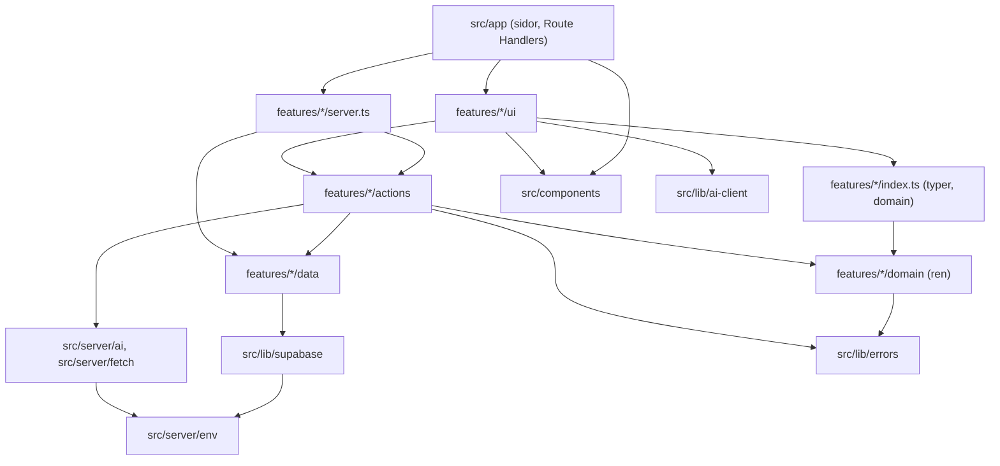
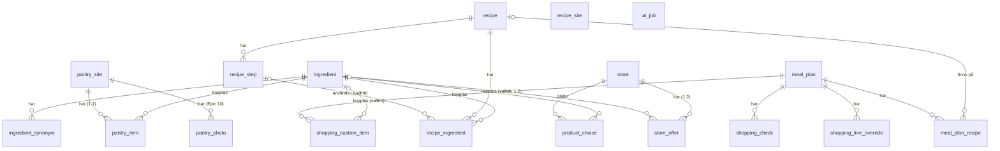
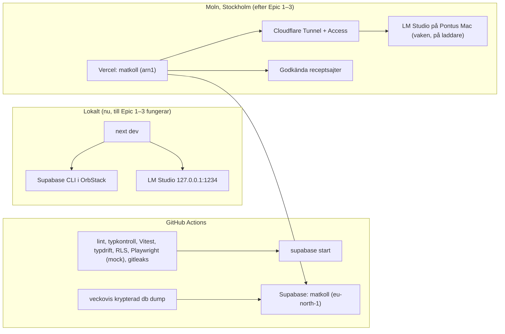

# Arkitektur – Matkoll

## Design Paradigm

**Modulär monolit** i en Next.js-app. Varje funktionsområde är en feature-modul med fyra lager. Externa tjänster (AI, receptsajter) nås bara via portar i `src/server/`.

| Lager | Plats | Får innehålla |
| --- | --- | --- |
| Route | `src/app/**` | Sidor, layouter, Route Handlers. Tunna: hämtar via modulernas `server.ts`, renderar `ui`. |
| UI | `src/features/<f>/ui/` | React-komponenter. Klientkomponenter anropar actions, `search*`-läsactions och `src/lib/ai-client.ts`. |
| Actions | `src/features/<f>/actions/` | Server Actions (`"use server"`) och serverfunktioner för AI-flöden: `requireUser()`, Zod-validering, anropar `domain`, `data` och portar. |
| Domain | `src/features/<f>/domain/` | Rena TypeScript-funktioner och Zod-scheman. Ingen I/O, inget React, ingen Next, ingen Supabase. |
| Data | `src/features/<f>/data/` | Supabase-frågor för modulens egna tabeller. `queries.ts` (läsning, `server-only`) och skrivfunktioner. |
| Portar | `src/server/ai/`, `src/server/fetch/` | AI-tjänsten och säker hämtning från receptsajter och, från 1.2, godkända erbjudandesidor. |

Feature-moduler och deras tabeller:

| Modul | Äger tabeller |
| --- | --- |
| `auth` | – (Supabase Auth) |
| `catalog` | `ingredient`, `ingredient_synonym` |
| `recipes` | `recipe`, `recipe_step`, `recipe_ingredient` |
| `pantry` | `pantry_item`, `pantry_site` (1.1, AD-24), `pantry_addition`, `pantry_removal`, `pantry_photo` och Storage-bucketen `pantry-photo` (Epic 10, AD-26) |
| `mealplan` | `meal_plan`, `meal_plan_recipe` |
| `shopping` | `shopping_check`, `shopping_line_override`, `shopping_custom_item`, `product_choice` |
| `suggestions` | – (läser via andra moduler) |
| `settings` | `recipe_site`, `store` |
| `ai-jobs` | `ai_job` (Epic 12, AD-28) |
| `offers` | `store_offer` (1.2, AD-25) |

## Invariants & Rules



Pilarna är de enda tillåtna beroendena. En annan modul nås bara via dess `index.ts` (typer och `domain`, säker i klient och server) eller `server.ts` (`server-only`: läsfunktioner från `data/queries.ts` och actions). Upprätthålls med ESLint `import/no-restricted-paths`; zonerna skrivs i första storyn.

### AD-1 – Lagerregler, ägarskap och ingångar

- **Binds:** all kod
- **Prevents:** affärslogik i sidor, moduler som läser eller skriver varandras tabeller, och Server Actions som används som läs-API.
- **Rule:** Beroenden följer diagrammet. Varje tabell skrivs och läses bara av sin ägarmodul (tabellen ovan); andra moduler använder ägarens exporterade läsfunktioner och actions. Server Actions används inte för läsning, utom `search*`-actions för sökning medan man skriver. Komponenter som behövs i flera moduler ligger i `src/components/`. Portar importerar aldrig `src/lib/supabase` eller `src/features/*`; det de behöver skickas in som argument. En skrivning som måste vara atomär görs som en Postgres-funktion (`security invoker`) i ägarmodulens migration och skriver bara ägarens tabeller. Flöden över flera moduler görs idempotenta i stället för atomära. Tillägg (Epic 12, AD-28): modulen `ai-jobs` äger `ai_job` och är allmän. Den importerar ingen annan feature-modul och vet inget om recept, lager eller förslag. Jobbrutterna i `src/app/api/ai/jobs/` sätter ihop ett jobb med modulens serverfunktion (route → `server.ts`), och klienterna når jobben via `src/lib/ai-jobs-client.ts`. Tillägg (1.2, AD-25): modulen `offers` äger `store_offer`. Den får importera `src/server/fetch` (bara `safeFetch`), som `recipes`. Inga andra moduler gör det. Etiketterna för erbjudanden sätts ihop av sidorna (route → ui), så att `shopping/ui`, `recipes/ui` och `mealplan/ui` aldrig importerar `offers`.

### AD-2 – En väg för ändringar

- **Binds:** alla skrivningar, FR-6, FR-16, FR-18, FR-25, NFR-1
- **Prevents:** skrivvägar som kringgår validering och inloggning, och AI-flöden som sparar utan bekräftelse.
- **Rule:** Webbläsaren använder aldrig Supabase-klienten. Läsning sker i Server Components via `server.ts`. Skrivning sker bara via Server Actions som börjar med `requireUser()` och validerar med Zod. Route Handlers under `src/app/api/ai/*` skriver aldrig till databasen; de anropar bara skrivfria funktioner, och resultatet lever i klienten tills Pontus sparar eller bekräftar via en Server Action. Undantag (Epic 10, AD-26): `POST /api/pantry/photo` sparar en plats senaste foto, eftersom en Server Action tar emot högst 1 MB och fotot kan vara 1,5 MB. Den är den enda Route Handler som skriver, och den gör samma kontroller som en Server Action: `isCrossSite`, `requireUserForRoute()`, `readImageForm` för bilden och Zod för övriga fält. Ändrat (Epic 12, AD-28): AI-resultat lever i den privata tabellen `ai_job` tills Pontus har stängt eller sparat dem, och i klienten som förut. `POST /api/ai/jobs` och `POST /api/ai/jobs/photo` skriver bara `ai_job`, med samma kontroller som ovan, och bara via Postgres-funktionerna i AD-28. Ingen AI-rutt skriver någon annan tabell, och inget AI-resultat sparas i en annan modul utan Pontus tryck. Avbryt, sett och stäng är Server Actions i `ai-jobs/actions`.

### AD-3 – Inloggning och tillåtelselista

- **Binds:** FR-1, NFR-1
- **Prevents:** konton utanför tillåtelselistan, sidor som bara skyddas av proxyn, och öppna omdirigeringar.
- **Rule:** Supabase Auth med engångslänk och `@supabase/ssr`-cookies. Registrering är avstängd (`enable_signup = false` lokalt och i molnet), `signInWithOtp` anropas med `shouldCreateUser: false`, och de tillåtna användarna skapas av skriptet `pnpm users:sync` (service role) från `ALLOWED_EMAILS`. Länken går till sidan `src/app/auth/confirm/page.tsx`, som bara visar knappen "Logga in"; först knappen (Server Action `confirmEmailLinkForm`, POST) anropar `verifyOtp({ token_hash, type: 'email' })`, så att en länkskanner i e-posten inte använder upp länken (Story 11.6); e-postmallen ligger i `supabase/config.toml` och sätts likadant i molnet. `src/proxy.ts` förnyar sessionen med `getClaims()` och omdirigerar till `/logga-in` (optimistisk kontroll). Den auktoritativa kontrollen är `requireUser()`: `getClaims()` plus att e-postadressen finns i `ALLOWED_EMAILS`, memoiserad per förfrågan med React `cache`. Den anropas i varje action, Route Handler och läsfunktion och ger `unauthorized` (401 i Route Handlers). Parametern `next` får bara vara en sökväg som börjar med `/` men inte `//`. Svaret på inloggningssidan är detsamma oavsett om adressen är tillåten. Tillägg (Epic 11, AD-27): samma mejl har också en sexsiffrig kod (`{{ .Token }}` i mallen, `otp_length = 6`). Server Action `verifyEmailCode(email, code, next)` i `auth` anropar `verifyOtp({ email, token, type: 'email' })` med sessionsklienten och kontrollerar sedan `ALLOWED_EMAILS` som `auth/confirm` gör. Fel kod, gammal kod och en adress som inte är tillåten ger samma svar. Koden behövs eftersom en app på iPhones hemskärm inte delar kakor med Safari, där länken öppnas. Före `verifyOtp` gäller appens egen gräns (5 fel koder per adress och klient-IP på 15 minuter, i minnet per serverinstans, `auth_code_rate_limited`) och tillåtelselistan; webbläsarens IP skickas till Supabase som `Sb-Forwarded-For`, och Supabases egen gräns ger också `auth_code_rate_limited`. Misslyckas utloggningen av en adress utanför listan tas sessionskakorna bort direkt.

### AD-4 – Dataisolering med RLS och grants

- **Binds:** FR-2, NFR-1, NFR-8, alla tabeller
- **Prevents:** tabeller utan skydd, skillnad mellan lokal miljö och moln, och rader som pekar på en annan användares data.
- **Rule:** Varje tabell i `public` har `user_id uuid not null default auth.uid() references auth.users on delete cascade`, RLS påslaget och en policy `user_id = (select auth.uid())` för select, insert, update och delete. Varje migration som skapar en tabell ger `grant select, insert, update, delete` till `authenticated` och `service_role`, aldrig till `anon`. `supabase/config.toml` har `[api] auto_expose_new_tables = false`. Barntabeller refererar föräldern med sammansatt främmande nyckel `(parent_id, user_id)`. Serverkod i förfrågningar använder användarens sessionsklient, aldrig service role; service role används bara i tester och skript. Varje ny tabell får ett RLS-test där en anonym klient och en annan användare varken kan läsa eller skriva (`42501` eller tomt resultat godtas). Tillägg (Epic 10, AD-26): en Storage-bucket är privat och skyddas av policyer på `storage.objects` med bucketens id och användarens id som första mapp i sökvägen. Den får samma slags RLS-test: en anonym klient och en annan användare kan varken ladda upp, läsa, lista eller ta bort. Tillägg (Epic 12): `ai_job` följer regeln som alla tabeller, och RLS-testet visar också att en annan användare varken kan läsa, avbryta eller ta över ett jobb med Postgres-funktionerna. Tillägg (Epic 21, Story 21.2a): datan ägs av **hushållet**, inte av kontot. Varje datatabell har `household_id uuid not null default public.my_household_id() references household on delete cascade`; policyn är `household_id = (select public.my_household_id())` för select, insert, update och delete, plus en restriktiv insert-policy `user_id = (select auth.uid())` (`user_id` betyder den som skapade raden). Barntabeller refererar föräldern med `(parent_id, household_id)`, och unika nycklar, `on conflict` och rådgivande lås bygger på `household_id`. `my_household_id()` och `is_household_member(hid)` är `security definer`, `stable`, `search_path = ''` och ges bara till `authenticated`. En person tillhör ett hushåll (`household_member.user_id` unik). Per person (utan `household_id`): `welcome_tour`, `api_key`, `feedback`; `app_owner` är appens. Storage-filer ligger kvar under `<user_id>/…`; policyn släpper fram en fil när en rad i ens hushåll pekar på den, eller när den ligger i en hushållsmedlems mapp och ingen rad i ett annat hushåll pekar på den. RLS-testet har två hushåll, A med två medlemmar och B med en, och listar själv tabellerna ur `information_schema` och `pg_policies`. Tabell för tabell: `docs/molnet.md`, "Hushållet i databasen".

### AD-5 – Schemaändringar

- **Binds:** alla tabeller
- **Prevents:** schema som skiljer mellan lokalt, CI och moln, och typer som glider från schemat.
- **Rule:** Schemat ändras bara via SQL-filer i `supabase/migrations/` skapade med `supabase migration new`. Efter varje migration körs `supabase gen types --local --schema public > src/lib/supabase/database.types.ts`, och CI misslyckas om den genererade filen skiljer sig. Migrationer är bakåtkompatibla med föregående koddriftsättning.

### AD-6 – Ingredienskatalogen äger matchningen

- **Binds:** FR-5, FR-6, FR-11, FR-17, FR-24, FR-25, FR-27
- **Prevents:** katalogposter från recept som aldrig sparas och avvisade lagerförslag, dubbletter, och olika matchningsregler i olika moduler.
- **Rule:** Bara `catalog` skriver `ingredient` och `ingredient_synonym`. Matchning sker i två steg:
  1. `matchIngredients(items: { text, hint? }[]): IngredientMatch[]` är skrivfri. Den matchar på normaliserat namn, sedan synonym. Utan träff returneras `{ kind: 'new', proposal: { name, section, location, defaultUnit } }` byggt från `hint`, som kommer från det AI-svar som redan finns (`parseRecipe`, `analyzeImage`). Träff ger `{ kind: 'match', ingredientId, confidence: 'exact' | 'synonym' }`.
  2. `commitIngredients(choices)` anropas bara från sparande actions (`saveRecipe`, `updateRecipe`, `confirmPantrySuggestions`, `setPantryItems`, `addCustomItem` när en katalogkoppling valts). Den skapar nya katalogingredienser med `insert … on conflict (user_id, normalized_name) do update … returning id` (sedan Story 21.2a `(household_id, normalized_name)`) och sparar originaltexten som synonym när Pontus valt en annan ingrediens än förslaget.

  Normalisering görs bara av `catalog/domain/normalize.ts` (gemener, trimmat, utan mängd och tillagningsord). `ingredient` är unik på `(user_id, normalized_name)`, `ingredient_synonym` på `(user_id, normalized)` (sedan Story 21.2a på `household_id` i stället för `user_id`). Receptrader, lagervaror, receptposter i listan och produktval refererar alltid `ingredient_id`; egna varor får sakna det.

### AD-7 – Mängdlogiken finns på ett ställe

- **Binds:** FR-8, FR-13, FR-15, FR-20, FR-22
- **Prevents:** att receptbiblioteket, matsedeln, receptvyn, rangordningen och inköpslistan räknar "finns hemma" och "Saknar N" olika.
- **Rule:** I `pantry/domain/`:
  - `aggregateNeeds(lines, factor)` summerar behov per `(ingredientId, unit)` och är det enda stället där behov summeras.
  - `coverage(need, snapshot)` är den enda jämförelsen mot lagret och returnerar `covered`, `partial` (kvarvarande mängd), `other-unit` (lagrets mängder), `missing` eller `vague-missing`. En vag rad är täckt om ingrediensen finns i lagret i någon form.
  - `recipeStatus(recipe, servings, snapshot)` ger lagningsstatus, "X av Y hemma" och "Saknar N". N är antalet distinkta katalogingredienser med `missing`, `partial` eller `other-unit`; vaga rader räknas inte. Varje recept jämförs mot hela lagret, utan att lagret fördelas mellan rätter. Att en matsedelsrätt visar "Kan lagas nu" medan listan föreslår samma vara är avsiktligt.
  - Skalning efter portioner sker bara i `recipes/domain/scale.ts`. Enheter räknas aldrig om.
  - Tillägg (1.1, AD-24): snapshoten gäller valt ställe. Lagret summeras aldrig över ställen, och ett recept jämförs aldrig mot två ställen på en gång.

### AD-8 – Inköpslistan räknas fram vid läsning

- **Binds:** FR-15, FR-16, FR-17, FR-18, FR-19, FR-26
- **Prevents:** en lagrad lista som blir inaktuell, bockar som tappas när lagret ändras, och vyer som tillämpar överlägget olika.
- **Rule:** `shopping/domain/computeList(input): ShoppingLine[]` är den enda källan till listposter för vyn, "Lägg i lagret" och exporten. `input = { plan, recipes, snapshot, catalog, overlay }`, och `overlay = { checks, overrides, customItems }`. Listnyckeln byggs bara av `shopping/domain/lineKey.ts`: receptpost `r:<ingredientId>:<unit|->` (vag rad ger `-`; täckningsstatus ingår aldrig), receptrad utan katalogingrediens `t:<normaliserad text>`, egen vara `c:<shopping_custom_item.id>`. Överlägget lagras per matsedel:
  - `shopping_check(meal_plan_id, line_key)` för alla bockar, även egna varor;
  - `shopping_line_override(meal_plan_id, line_key, amount, hidden)` för rättad mängd och dold post;
  - `shopping_custom_item` för egna varor, som aldrig slås ihop med receptposter och grupperas under katalogingrediensens avdelning eller Övrigt.

  `ShoppingLine = { key, ingredientId?, label, amount, unit, isVague, coverage, pantryNote?, section, origins: mealPlanRecipeId[], checked, isCustom }`. "Lägg i lagret" (`shopping/actions/putCheckedInPantry`) skickar avbockade poster till `pantry.addToPantry` (vag post blir obegränsad lagervara), tar bort egna varor utan katalogkoppling och rensar sedan bockarna och överstyrningarna för de nycklarna. Upprepas flödet blir resultatet detsamma.

  Tillägg (1.1, AD-24): `input.snapshot` är snapshoten för valt ställe. Stället ingår aldrig i listnyckeln, överlägget, produktvalen eller exporten. Ett byte av ställe räknar om listan, och bockar och överstyrningar står kvar under sina nycklar. `getShoppingList` lämnar `site` bredvid listan, och "Lägg i lagret" lägger på det ställe som listan räknades mot (`putCheckedInPantry(siteId)`).

### AD-9 – AI-tjänsten är en port

- **Binds:** FR-3, FR-4, FR-5, FR-23, FR-24, FR-34, FR-36, FR-45, FR-50, FR-54, NFR-2, NFR-7
- **Prevents:** leverantörsspecifik kod i modulerna, ovaliderade AI-svar, anrop som inte går att avbryta och en sovande Mac som låser appen.
- **Rule:** `src/server/ai/` exporterar `AiService` med `parseRecipe`, `analyzeImage` och `suggestDishes`. Alla tar en `AbortSignal`. Adaptrarna `lmstudio`, `anthropic`, `openai` och `mock` väljs med `AI_PROVIDER`; bara `src/server/ai/` får importera `ai` och `@ai-sdk/*`.
  - Anrop görs med `generateText` och `Output.object({ schema })`, aldrig `generateObject`. Bilder skickas som `file`-delar.
  - `lmstudio` skapas med `createOpenAICompatible({ baseURL, supportsStructuredOutputs: true, headers })`, där `headers` bär Cloudflare Access-token när de finns, och tänkläget stängs av i anropet.
  - SDK:ns `maxRetries` är 0. Porten gör högst två nya försök vid ogiltigt svar (`ai_invalid`). Nätverksfel, tidsgräns för anslutning (5 s) eller svar som inte är JSON ger `ai_unavailable` utan nya försök. Tidsbudget: 100 s per försök, 115 s totalt (ändrad 2026-10-25 efter Story 1.8: Qwen i LM Studio behöver 40–56 s för fulla recept). Ett nytt försök görs bara om tiden räcker.
  - Svarsscheman finns i `src/server/ai/schemas.ts` och promptar som filer i `src/server/ai/prompts/`. `mock` är deterministisk och används i alla tester och i CI.
  - AI-flöden startas från klienten via `src/lib/ai-client.ts` till Route Handlers i `src/app/api/ai/*` (`maxDuration = 120`). Handlern anropar modulens serverfunktion (t.ex. `recipes/actions/importRecipe.ts`) och skickar vidare `request.signal`. AI anropas aldrig vid rendering eller i `data`.
  - Ändrat (Epic 12, AD-28):
    - Bildanalys, AI-förslag och receptimport körs som AI-jobb. Klienten startar dem via `src/lib/ai-jobs-client.ts` till `POST /api/ai/jobs` (JSON) och `POST /api/ai/jobs/photo` (multipart), med `maxDuration = 300`. Jobbet körs i `after()` med en egen `AbortController` och en egen tidsgräns, aldrig med `request.signal`, som inte längre gäller när svaret har skickats. De gamla rutterna (`analyze`, `locate`, `suggest`, `import`, `import/photo`) tas bort i den story som flyttar flödet.
    - Porten får `warmUp(kind: 'image' | 'text', signal)`: ett anrop med flödets systemprompt, minimal indata och `maxOutputTokens: 1`, utan schema och utan nya försök, högst 30 s. Bara `lmstudio` gör något; `mock`, `anthropic` och `openai` svarar direkt. Den anropas bara från `POST /api/ai/warm` (12.2).
    - `suggestDishes` får en strömmande variant (`suggestDishesStream(input, signal, { onDish })`, 12.7) med `streamText` och `Output.array({ element })`, där `elementStream` ger varje färdig, validerad rätt. Det är det enda undantaget från `generateText` med `Output.object`. Samma tidsbudget, samma hälsokontroll och samma regel för nya försök: ett nytt försök görs bara när ingen giltig rätt har kommit.
    - `mock` tar en fördröjning per anrop från `AI_MOCK_DELAY_MS` (AD-14), så att kön kan provas i e2e.
  - Tillägg (1.2, AD-25):
    - `suggestDishes` får `offers: string[]` (varornas namn, aldrig priser). En tom lista ger samma meddelande som utan erbjudanden.
    - Porten får `planWeek` (veckans matsedel, jobbet `weekplan`, med det kompakta schemat från AD-10) och `extractOffers` (text eller bild till erbjudanden, jobbet `offers`), med samma regler som de andra metoderna. Om Story 9.10 byggs får den också `matchOffers`, som bara väljer bland befintliga katalogingredienser.
    - Läsningen av en butiks erbjudandesida görs aldrig med AI (AD-25).

### AD-10 – Ett receptformat

- **Binds:** FR-3, FR-4, FR-5, FR-6, FR-10, FR-21, FR-23
- **Prevents:** olika importvägar som ger olika format, och redigering som tappar stegkopplingar.
- **Rule:** `parseRecipe` och `suggestDishes` returnerar samma `AiRecipe`-schema (med katalogförslag per rad). `recipes/domain/fromAiRecipe(aiRecipe, matches): RecipeDraft` är den enda mappningen och används för länk, text, foto och AI-förslag. `RecipeDraft` (Zod) innehåller titel, originalportioner, total tid i minuter, bild-URL, `sourceKind` (`url | text | photo | ai`), `sourceUrl` (bara för `url`), steg och receptrader. Varje receptrad har originaltext, mängd, enhet, vag, `ingredient: IngredientMatch | { kind: 'chosen', ingredientId }` och valfria stegindex. Inget importflöde skriver till databasen. `saveRecipe(draft)` och `updateRecipe(id, draft)` är de enda skrivvägarna; `updateRecipe` behåller id för rader och steg som finns kvar och översätter stegindex till id. AI-förslag finns bara i klientens tillstånd tills de sparas. Visningstexten för källa väljs bara i `recipes/domain/sourceLabel()`. Tillägg (Epic 12): `suggestDishes` ber modellen om ett kompaktare svar (`suggestDishesAnswerCompact` i `schemas.ts`): receptraden har `text`, `amount`, `unit`, `name` och `stepIndexes`, och `new` (avdelning, plats och enhet) bara för en vara som inte finns i lagret. Porten gör om det till `AiRecipe` (`isVague` när `amount` är `null`, `hint` från `name` och `new`, annars Övrigt, Skafferi och raden eller `st` som enhet), så att `fromAiRecipe` och allt efter är oförändrat. `parseRecipe` behåller hela schemat. Ett AI-förslag och en import i ett jobb lagras som det färdiga resultatet (`RecipeDraft`) i `ai_job.result` tills Pontus sparar eller stänger det (AD-28).

### AD-11 – Hämtning från receptsajter

- **Binds:** FR-3, FR-7, NFR-1, NFR-8, och från 1.2 FR-34 och NFR-10
- **Prevents:** SSRF, hämtning från ej godkända domäner, och AI-normalisering som hoppas över.
- **Rule:** `src/server/fetch/safeFetch(url, { allowedDomains, signal })` är den enda kod som hämtar från receptsajter. Anroparen läser domänlistan via `settings`. Krav: bara https; värden ska vara en domän i listan eller dess `www.`-variant; DNS slås upp och privata, lokala och reserverade adresser avvisas; omdirigeringar följs manuellt med ny kontroll (högst 3); 10 s tidsgräns; högst 3 MB. Kontrollen sker före varje anslutning och testas i CI med sparade sidor från koket.se och tasteline.com. JSON-LD (`schema.org/Recipe`) skickas, om den finns, som indata till `parseRecipe` tillsammans med sidans läsbara text; den används aldrig direkt som `RecipeDraft`. Domäner som Pontus lägger till valideras och normaliseras av ett Zod-schema i `settings/domain` (gemener, utan schema, sökväg och `www.`). Tillägg (1.2, AD-25), beslutat av Pontus 2026-10-26: `safeFetch` hämtar också butikers erbjudandesidor, med samma kontroller, men bara från den fasta listan `OFFER_SITES` i `settings/domain/offers-link.ts` (i 1.2 `www.ica.se`, sökvägen `/erbjudanden/<slug>-<siffror>/`) och bara den adress som är sparad i `store.offers_url`. Erbjudandesidor blir aldrig receptsajter, och receptsajterna används aldrig för erbjudanden. Anroparen (`offers/actions/fetchStoreOffers`) skickar `OFFERS_USER_AGENT`, en ärlig User-Agent i samma form som receptimportens. Inga kakor, inga huvuden som efterliknar en webbläsare, en hämtning per tryck och inget nytt försök efter 403 eller 429. Testerna hämtar bara från `tests/fixtures/sites/` via `fixture-sites.ts`.

### AD-12 – Enheter, mängder, avdelningar och platser

- **Binds:** FR-5, FR-11, FR-12, FR-15, FR-16, FR-19, FR-20, FR-26
- **Prevents:** att "dl" och "deciliter" blir olika listposter, olika formatering av mängder, och egna stavningar av avdelningar och platser.
- **Rule:** I `catalog/domain/`:
  - `units.ts`: enheterna `g, kg, ml, cl, dl, l, krm, tsk, msk, st, förp, klyfta, kruka, knippe, skiva`; `normalizeUnit(raw)` med alla alias (t.ex. "deciliter" → `dl`, "paket" → `förp`), `parseQuantity(text)` ("1,5", "½") och `formatQuantity(amount, unit)` (svenskt decimalkomma). De är de enda tolknings- och visningsfunktionerna. En okänd enhet gör raden vag med originaltexten kvar.
  - `sections.ts`: Frukt och grönt, Bröd, Mejeri, Kött och fisk, Chark, Frys, Skafferi, Dryck, Övrigt, i den ordningen. Okänd avdelning blir Övrigt.
  - `locations.ts`: Kyl, Frys, Skafferi.

  Alla tre är Zod-enum som AI-scheman, formulär och listans gruppering använder, och `text`-kolumner med `check` i databasen. Mängd lagras som `numeric`, `null` för vag rad (`is_vague = true`) och obegränsad lagervara. Avrundning sker bara i `formatQuantity`.
  - Tillägg (Epic 11): `categories.ts` med `CATEGORIES` (Frukt & grönt, Bröd, Mejeri & ägg, Kött, fisk & chark, Frys, Skafferi, Såser & smaksättare, Dryck, Övrigt, i den ordningen) och `displayCategory(section, name): Category`, den enda regeln för vilken kategori en vara visas under. Kött och fisk och Chark blir en kategori, och en vara i Skafferi vars normaliserade namn är eller slutar på ett ord i listan `SAUCE_WORDS` (sås, senap, ketchup, majonnäs, dressing, vinäger, buljong, fond, salt, peppar, krydda, kryddor …) blir Såser & smaksättare. Kategorin är ren visning: den sparas aldrig, AI-scheman och promptar använder fortfarande avdelningarna, och exporten (AD-16) grupperar fortfarande per avdelning. Ikon och platta per kategori väljs bara i `src/components/category-header.tsx`.

### AD-13 – Resultat och fel

- **Binds:** alla actions och Route Handlers, NFR-6
- **Prevents:** olika felformer per modul och engelska tekniska fel i gränssnittet.
- **Rule:** Actions och Route Handlers returnerar `{ ok: true, data } | { ok: false, error: { code, message } }`. `code` namnges `<område>_<orsak>` och finns i `src/lib/errors.ts` tillsammans med den svenska texten (Voice and Tone i `EXPERIENCE.md`), t.ex. `unauthorized`, `validation`, `fetch_domain_not_allowed`, `fetch_blocked`, `fetch_timeout`, `fetch_too_large`, `import_no_recipe`, `ai_unavailable`, `ai_invalid`, `image_too_large`. Förväntade fel kastas aldrig till klienten. Tillägg (Epic 12): `ai_queue_full`, `ai_queue_timeout`, `ai_job_lost` och `ai_job_gone` (AD-28). Ett jobb som misslyckas sparar sin felkod i `ai_job.error_code`, och klienten visar texten från `errors.ts` som för ett direkt svar.

### AD-14 – Konfiguration och hemligheter

- **Binds:** NFR-1, NFR-2, NFR-8
- **Prevents:** nycklar i klientkod, variabler med olika namn och saknade värden som upptäcks först vid anrop.
- **Rule:** All miljö läses via `src/server/env.ts` (`server-only`), validerad med Zod vid start. Godkända namn: `NEXT_PUBLIC_SUPABASE_URL`, `NEXT_PUBLIC_SUPABASE_PUBLISHABLE_KEY`, `SUPABASE_SERVICE_ROLE_KEY` (bara tester och skript), `SITE_URL` (appens publika adress, används i länkar i e-post), `ALLOWED_EMAILS`, `AI_PROVIDER`, `AI_MODEL`, `LMSTUDIO_BASE_URL`, `CF_ACCESS_CLIENT_ID`, `CF_ACCESS_CLIENT_SECRET`, `ANTHROPIC_API_KEY`, `OPENAI_API_KEY`, och från Epic 12 `AI_MOCK_DELAY_MS` (heltal i millisekunder, högst 30 000, läses bara när `AI_PROVIDER=mock` och sätts aldrig i Vercel), och från Epic 20 `OWNER_EMAIL` (appens ägare; appen läser den bara för namnet i Tyck till-bladen, åtkomsten till inkorgen avgörs i databasen av `is_app_owner()` och tabellen `app_owner`, som håller ägarens användar-id, aldrig adressen, och som `pnpm owner:sync` fyller genom att slå upp adressen). Nya variabler kräver en ändring av den här listan och `.env.example`. Hemligheter ligger i `.env.local` lokalt och i Vercels miljö i molnet.

### AD-15 – Bilder

- **Binds:** FR-4, FR-8, FR-24, FR-37
- **Prevents:** lagrade privata foton utanför den enda regeln nedan, uppladdningar som stoppas av Vercels gräns på 4,5 MB, och trasiga receptbilder.
- **Rule:** Foton av kokbokssidor och platser förminskas i klienten till högst 1600 px för en kokbokssida och 2048 px för en plats (Story 6.5, `maxPlacePhotoSide`), och högst 1,5 MB (JPEG), före uppladdning, kontrolleras på servern (`image_too_large`), skickas till AI-tjänsten och sparas aldrig. Receptbilder sparas som URL och visas med `` och en platshållare vid fel. Ingen CSP i v1.
- **Ändrat (Epic 10, AD-26):** ett undantag, och bara ett. Det senaste fotot av en plats (Kyl, Frys eller Skafferi på ett ställe) sparas när det har lett till en ändring i lagret, alltså när den första skrivningen från fotots lagerförslag har lyckats. Det som sparas är den förminskade bild som AI-tjänsten fick, utan metadata (EXIF, GPS, XMP, ICC och kommentarer tas bort på servern), i en privat bucket och med avläsningen och punkterna från 6.5 och 6.6. Högst ett foto per plats, och aldrig äldre än 30 dagar. Foton av kokbokssidor sparas fortfarande aldrig, inte heller ett platsfoto vars förslag bara avvisades. Ett sparat foto skickas aldrig till AI-tjänsten igen. Detaljerna står i AD-26.
- **Tillägg (1.2, AD-25):** ett foto av ett reklamblad eller en skärmbild av en erbjudandesida behandlas som ett foto av en plats: 2048 px och 1,5 MB, skickas till AI-tjänsten i ett jobb och sparas aldrig, inte heller som senaste foto (AD-26).
- **Tillägg (Epic 12, AD-28):** ett foto i ett AI-jobb finns bara i minnet i den förfrågan som tog emot det, medan jobbet väntar i kön och körs. Det sparas aldrig i `ai_job`, på disk eller i loggar, och ingen annan förfrågan kan köra jobbet. Klienten behåller fotot i minnet (aldrig i `localStorage`, `sessionStorage` eller IndexedDB) tills resultatet har stängts, för granskningen och det senaste fotot (AD-26).

### AD-16 – Varukorgsexporten

- **Binds:** FR-26, FR-27, FR-28
- **Prevents:** en export som ändras utan att instruktionen till Claude in Chrome följer med, och en export som ber agenten beställa.
- **Rule:** `shopping/domain/exportBasket(lines, store, choices)` skapar texten. Den börjar med `Matkoll varukorgsexport v1` och innehåller butikens namn, kedja, butiks-id, adress och URL, sedan de poster som inte är avbockade, dolda eller vaga, grupperade i avdelningsordning, med mängd från `formatQuantity` och produktval när det finns, och sist den ordagranna instruktionen i `docs/varukorgsexport.md`, som innehåller "Beställ inte" och "rapportera varor du är osäker på i en separat lista". Formatet låses med ett golden-file-test; en ändring höjer versionen. Texten byggs i klienten av redan laddad listdata, så att `navigator.clipboard.writeText` körs direkt i tryckhändelsen. `product_choice` ägs av `shopping` och är unik på `(user_id, ingredient_id, store_id)`; `settings` äger `store` (högst en `is_selected`).

### AD-17 – Designtokens

- **Binds:** NFR-3, NFR-4, NFR-5, all UI
- **Prevents:** hårdkodade färger och mått som glider från `DESIGN.md`.
- **Rule:** Tokens från `DESIGN.md` definieras som CSS-variabler i `:root` i `src/app/globals.css` och mappas med Tailwind `@theme inline`. Mörkt läge byter variablerna i `@media (prefers-color-scheme: dark)`. Tailwind körs via `@tailwindcss/turbopack` som i startmallen, utan PostCSS-konfiguration. Komponenter använder bara tokenklasser, aldrig hex-värden. Tillägg (Epic 11): plattornas färger `tile-clay` och `tile-lilac` är tokens som de andra, med mörka värden. Emoji används bara som ikon i kategoriplattorna, med `aria-hidden`, och aldrig i texter (`src/lib/errors.ts`, knappar, bekräftelser). Appikonens färger läses från `src/app/theme-colors.ts`, som ett test jämför med `globals.css`, så att ingen hex finns utanför `globals.css`.

### AD-18 – Rendering och cache

- **Binds:** alla sidor och actions
- **Prevents:** byggfel från sessionsläsning utanför `<Suspense>`, cachad användardata och inaktuella härledda vyer.
- **Rule:** `cacheComponents: true` behålls som i startmallen. Allt som läser sessionen eller användardata renderas i en komponent inuti `<Suspense>`; en layout gör aldrig `await` på sessionen på toppnivå. Ingen `'use cache'` på användardata i v1. Route segment config begränsas till `maxDuration`. Efter en skrivning anropar actionen `revalidateFor(table)` från `src/lib/revalidate.ts`, som mappar tabell till alla rutter som visar den eller något härlett ur den (t.ex. `pantry_item` → `/hemma`, `/recept`, `/recept/[id]`, `/matsedel`, `/lista`). `revalidatePath` anropas inte direkt. Tillägg (1.1, AD-24): `pantry_site` → `/hemma`, `/recept`, `/matsedel`, `/lista`, eftersom ett byte av ställe ändrar allt som räknas mot lagret. Tillägg (Epic 10, AD-26): `pantry_photo` → `/hemma`, eftersom fotot bara visas där. Tillägg (Epic 12, AD-28): `ai_job` revalideras aldrig. Tillägg (1.2, AD-25): `store_offer` → `/recept`, `/lista` och `/matsedel` (layout), och `store` får också `/lista` och `/matsedel`, eftersom etiketterna följer vald butik. Ingen sida renderar jobb på servern; klienten läser dem med pollning. Klientkomponenter med effekter (t.ex. Wake Lock i stegläget) städar upp i effektens cleanup och återtar resurser vid `visibilitychange`.

### AD-19 – Lagervarans identitet och skrivoperationer

- **Binds:** FR-11, FR-12, FR-19, FR-25
- **Prevents:** dubbla lagerrader och att "lägg till", "sätt" och "öka" får olika betydelse i olika moduler.
- **Rule:** `pantry_item` är unik på `(user_id, ingredient_id, location, unit)` med `unit` `null` för obegränsad (`nulls not distinct`). `pantry` exporterar exakt dessa skrivoperationer:
  - `addToPantry(items)`: ökar en rad med samma ingrediens, plats och enhet eller skapar en. Om ingrediensen redan är obegränsad ändras inget. Saknad plats blir katalogingrediensens plats. Används av "Lägg i lagret".
  - `setPantryItems(items)`: sätter mängden exakt och skapar raden vid behov. Används av arket Lagervara och bekräftade lagerförslag.
  - `removePantryItem(id)` returnerar den borttagna raden, och `restorePantryItem(row)` sätter tillbaka den med samma id.

  Läsning sker med `getPantrySnapshot(): Map<ingredientId, { unlimited, amounts: { unit, amount }[] }>`, summerad över platser, och `listPantry(location)` för vyn. `coverage` tar bara emot snapshot.

  Ändrat (1.1, AD-24): den unika nyckeln är `(user_id, site_id, ingredient_id, location, unit)` med `nulls not distinct`. Varje skrivoperation tar `siteId` från vyn. `getPantrySnapshot(siteId?)`, `listPantry(location, siteId?)` och `countPantryItems(siteId?)` gäller ett ställe (valt ställe om inget anges), summerat över ställets platser och aldrig över ställen. Skrivoperationerna från Epic 6 (`emptyPantryPlace`, `restorePantryRemoval`, `confirmPantryInventory`) och `confirmPantrySuggestions` hör också hit.

  Tillägg (Epic 11): `pantry_item.label` är varans märke eller sort (`text`, `null` eller 1–60 tecken efter trim). Det ingår inte i den unika nyckeln. `setPantryItems` tar `label` per vara: saknas fältet står märket kvar, `null` tar bort det och en text sätter det. `confirmPantrySuggestions` och `confirmPantryInventory` skickar förslagets första etikett (6.5), avkortad till 60 tecken, när förslaget har en. `addToPantry` rör aldrig märket. `created_at` betyder "tillagd": en ändrad mängd ändrar den inte, och när `setPantryItems` ersätter en rad (ny enhet eller plats, `replace_id`) får den nya raden den ersattas `created_at` och `label`. `listPantry` ger `label`, `createdAt` och katalogingrediensens avdelning, så att vyn kan räkna kategorin (AD-12).

### AD-20 – Referenser och borttagning

- **Binds:** FR-10, FR-14, alla främmande nycklar
- **Prevents:** borttagningar som tyst raderar data i andra moduler eller misslyckas med generiska fel, och "Ångra" som ger nya id.
- **Rule:** Främmande nycklar mellan moduler är `on delete restrict`. Inom ett aggregat (recept med steg och rader, matsedel med rätter och överlägg) är de `cascade`. Undantag: `meal_plan_recipe.recipe_id` är `on delete set null`, och raden har `recipe_title` som ögonblicksbild, så tidigare matsedlar visar "Borttaget recept". `recipes.deleteRecipe` anropar först `mealplan.detachRecipe(recipeId)`, som tar bort rätten från den aktuella matsedeln. Katalogingredienser tas inte bort och slås inte ihop i v1. All radering är hård; "Ångra" anropar `restore*(row)` med samma id, och create-actions tar emot ett valfritt id för det. Tillägg (Epic 10, AD-26): `pantry_photo` hör till ställets aggregat, så `pantry_photo (site_id, user_id)` är `on delete cascade` mot `pantry_site`. Filen i Storage följer inte med en kaskad i databasen, så den som tar bort raden tar också bort filen via Storage-API:t. Ett foto går inte att ångra, så "Ta bort fotot" har en kontrollfråga. Tillägg (Epic 11): "Ångra" sätter tillbaka allt på raden, också `created_at` och `label`. `restore_pantry_item` tar emot dem, och `pantry_removal.removed_rows` sparar dem för `restore_pantry_removal`. En `created_at` i framtiden blir `now()`.

### AD-21 – Startdata per användare

- **Binds:** FR-7, FR-28
- **Prevents:** att import saknar godkända sajter i molnet, och startdata som skapas på flera sätt.
- **Rule:** Postgres-funktionen `ensure_user_defaults()` (ägs av `settings`, `security invoker`, idempotent med `on conflict do nothing`) lägger in `koket.se` och `tasteline.com` i `recipe_site` och Maxi ICA Stormarknad Östersund (ICA Handla, butiks-id 1003733) som vald `store`. Den anropas av `auth/confirm` efter lyckad inloggning och av testernas setup. `seed.sql` skapar bara lokala testanvändare. Tillägg (1.1, AD-24): `pantry` har en egen funktion för sin startdata, `ensure_pantry_defaults()` (`security invoker`, idempotent), som skapar stället "Hemma" som valt. `auth/confirm` anropar den efter `ensure_user_defaults()`, och testernas setup anropar båda. En modul skriver aldrig en annan moduls startdata (AD-1).

### AD-22 – Aktuell matsedel

- **Binds:** FR-13, FR-14, FR-15
- **Prevents:** flera aktuella matsedlar, och moduler som skapar matsedlar på egen hand.
- **Rule:** `meal_plan.is_current` är unik per användare (partiellt unikt index). `mealplan.addToCurrentPlan(recipeId, servings?)` skapar en aktuell matsedel om ingen finns och lägger alltid till en ny `meal_plan_recipe`-rad (samma recept får förekomma flera gånger). Byte av aktuell matsedel och "Använd igen" görs bara av Postgres-funktionen `set_current_meal_plan(id)`. Inköpslistan, bockar och överstyrningar gäller den aktuella matsedeln.

### AD-23 – Leverans och driftsättning

- **Binds:** NFR-7, NFR-8
- **Prevents:** kod i `main` som inte passerat kontrollerna, publicering utan Pontus godkännande, och schema och kod som driftsätts i fel ordning.
- **Rule:**
  - En gren per epic (`epic/1-receptimport`), PR till `main`. `main` är skyddad: obligatoriska kontroller (lint, typkontroll, Vitest, typdrift, RLS-tester, domänbegränsning, Playwright, gitleaks) och en genomförd kodgranskning (`bmad-code-review`) innan sammanslagning.
  - Före commit kör `lefthook` `gitleaks protect --staged` och ESLint på ändrade filer.
  - CI-actions pinnas på huvudversion (`gitleaks/gitleaks-action@v3`, `supabase/setup-cli@v3`). `package.json` har `"engines": { "node": "24.x" }`.
  - Produktion byggs bara från `main`. Förhandsdriftsättningar saknar Supabase-variabler. `supabase db push` körs före koddriftsättningen. Första publiceringen i produktion kräver Pontus godkännande.
  - Vercel och Supabase ligger i Stockholm (Vercel `arn1`, Supabase `eu-north-1`).
  - Ett schemalagt GitHub Actions-flöde gör varje vecka en krypterad `supabase db dump` (lösenfras som hemlighet) och sparar den som artefakt. Det håller också gratisprojektet aktivt.
  - Tillägg (Epic 10, AD-26): CI startar Supabase med `storage-api` (det står inte längre i `SUPABASE_EXCLUDE`), eftersom migrationen skapar en bucket och RLS-testerna och e2e behöver Storage. Säkerhetskopian tar aldrig med foton: filerna finns inte i en databasdump, och raderna i `storage.objects` och `pantry_photo` utesluts. Bucketen och dess policyer ligger i schemat `storage`, som dumpen inte tar med, så återställningen kör fotomigrationen igen (`docs/drift.md`).
  - Tillägg (Epic 12, AD-28): säkerhetskopian utesluter raderna i `ai_job` (bara schemat tas med), eftersom de är tillfälliga resultat. Jobbrutterna har `maxDuration = 300`, taket på Vercel Hobby med Fluid compute.

### AD-24 – Ställen i lagret

- **Binds:** FR-29, FR-30, FR-31, FR-32, FR-33, NFR-9, och i 1.1 också FR-8, FR-11, FR-12, FR-13, FR-15, FR-19, FR-20, FR-22, FR-23, FR-24 och FR-25
- **Prevents:**
  - lager som summeras över ställen;
  - moduler som själva avgör vilket ställe som gäller;
  - skrivningar som hamnar på fel ställe när stället byts mitt i ett flöde;
  - en migrering som tappar, flyttar eller dubblerar lagervaror.
- **Rule:**
  - **Data:**
    - `pantry` äger `pantry_site` (`id`, `user_id`, `name`, `normalized_name`, `is_selected`, `created_at`).
      - Den är unik på `(id, user_id)` för sammansatta nycklar och på `(user_id, normalized_name)`.
      - Ett partiellt unikt index, `(user_id) where is_selected`, ger högst ett valt ställe.
      - En `check` begränsar namnet till 1–40 tecken.
      - Normaliseringen görs bara av `pantry/domain/site.ts`: trimmat, gemener och enkla mellanslag.
      - RLS, grants och RLS-test enligt AD-4.
    - `pantry_item.site_id uuid not null` refererar `pantry_site (id, user_id)` via `(site_id, user_id)` med `on delete restrict`, så ett ställe med varor kan inte tas bort.
    - Den unika nyckeln blir `(user_id, site_id, ingredient_id, location, unit) nulls not distinct` (AD-19), och indexet `(user_id, site_id, location)` ersätter `(user_id, location)`. Regeln "obegränsad eller mängder" gäller per ställe och plats.
    - Raderna som sparas i `pantry_removal.removed_rows` har `site_id`. `pantry_addition` ändras inte.
    - Platserna (Kyl, Frys, Skafferi, AD-12) är desamma på alla ställen. Ett ställe är aldrig en plats.
  - **Valt ställe:**
    - Varje användare med ställen har exakt ett valt ställe.
    - Bara Postgres-funktionen `select_pantry_site(site_id)` byter valt ställe. Den låser användarens ställen och slår av det gamla och på det nya i en transaktion (samma mönster som `select_store`).
    - `save_pantry_site(id, name)` skapar ett ställe eller byter namn på det, och nekar fler än 10 ställen per användare.
    - `delete_pantry_site(id)` nekar valt ställe, ett ställe med varor och det sista stället.
    - Alla tre tar `pantry_lock()`.
    - Matkoll byter aldrig ställe på egen hand.
  - **Läsning:**
    - `pantry/server.ts` exporterar `getSelectedSite(): { id, name, siteCount } | null`, `listPantrySites()`, `getPantrySnapshot(siteId?)`, `listPantry(location, siteId?)` och `countPantryItems(siteId?)`.
    - Utan `siteId` gäller valt ställe.
    - Funktionerna memoiseras per förfrågan med React `cache`, så att en sida läser valt ställe en gång och alla delar av sidan visar samma ställe.
    - Ingen funktion summerar lagret över ställen.
    - En användare utan ställen (före `ensure_pantry_defaults`) har ett tomt lager, och `getSelectedSite()` ger `null`.
  - **Skrivning:**
    - Pantry-skrivningarna (`setPantryItems`, `addToPantry`, `removePantryItem`, `restorePantryItem`, `confirmPantrySuggestions`, `confirmPantryInventory`, `emptyPantryPlace` och `restorePantryRemoval`) tar ställets id från den vy som klienten visade (FR-33), aldrig det ställe som är valt när anropet kommer fram.
    - Postgres-funktionerna får parametern `site uuid default null` sist. `null` betyder valt ställe. Det finns bara för att 1.0-koden ska fungera under driftsättningen (AD-5). Ny kod skickar alltid `site`.
    - Saknar användaren ställen skapar skrivfunktionen "Hemma" som valt, via hjälpfunktionen `pantry_selected_site()`.
    - "Ångra" (`restore_pantry_item` och `restore_pantry_removal`) sätter tillbaka på radens eget `site_id`.
    - Ett ställe som har tagits bort ger felkoden `pantry_site_gone` och ingen skrivning.
  - **Andra moduler:**
    - `recipes`, `mealplan`, `suggestions` och `shopping` anropar `getPantrySnapshot()` utan argument, alltså för valt ställe, och `getSelectedSite()` när de visar raden "Lager: <namn>".
    - `shopping.getShoppingList` lämnar `site` bredvid listan, som `store`. `putCheckedInPantry(siteId)` skickar listans ställe vidare till `addToPantry`.
    - Ställets id ingår aldrig i listnycklar, bockar, överstyrningar, egna varor, produktval eller exporten (AD-8, AD-16).
    - `/api/ai/analyze` tar emot `site` och `location` och läser platsen på det stället. AI-porten får bara platsen (AD-9 är oförändrad).
    - Ingen annan modul läser eller skriver `pantry_site` (AD-1).
  - **UI:**
    - Ställesväljaren, arket Ställen och arket Byt ställe är komponenter i `pantry/ui`, och `selectPantrySite`, `savePantrySite` och `deletePantrySite` är Server Actions i `pantry/actions`.
    - Sidorna `/hemma` och `/lista` renderar komponenterna (route → ui). `shopping/ui` importerar dem inte.
    - Valt ställe lagras inte i adressen. `?plats=` i Hemma är oförändrad.
  - **Startdata:** `ensure_pantry_defaults()` (AD-21).
  - **Migrering (Story 8.1):** en migration i en transaktion som bara lägger till.
    1. Skapa `pantry_site`.
    2. Lägg in "Hemma" som valt ställe för varje användare i `auth.users`.
    3. Lägg till `pantry_item.site_id`, fyll den med användarens "Hemma", sätt `not null` och lägg till den sammansatta nyckeln.
    4. Byt den unika nyckeln och indexet.
    5. Lägg `site_id` på raderna i `pantry_removal.removed_rows`.
    6. Ersätt pantry-funktionerna med versioner som har parametern `site`. Pantry-läsningarna i 1.0-koden går via PostgREST och läser alla rader, vilket är detsamma som "Hemma" så länge det är det enda stället.

    Ett integrationstest visar att lagret har samma rader, mängder och id före och efter, och att 1.0:s anrop utan `site` fortfarande fungerar.
  - **Rendering:** `revalidateFor('pantry_site')` (AD-18).
  - **Tillägg (1.2, AD-25):** `pantry/server.ts` får `listStockedSites(ingredientIds): Map<ingredientId, siteId[]>` för "Fyll på lagret". Den säger bara på vilka ställen en katalogingrediens finns, aldrig mängder, och summerar aldrig lagret över ställen.

### AD-25 – Veckans erbjudanden

- **Binds:** FR-34, FR-35, FR-36, FR-51, FR-52, FR-53, FR-54, NFR-10, och i 1.2 också FR-23 och FR-28
- **Prevents:**
  - hämtning från andra butiksadresser än en godkänd erbjudandesida, hämtning utan Pontus tryck och nya försök mot en butik som har sagt nej;
  - att kod från en butiks sida körs, och att sidans sessionsdata (nycklar, kakor, interna adresser) sparas eller loggas;
  - tester som anropar en butik;
  - AI-svar om erbjudanden som sparas utan att Pontus har sett dem;
  - erbjudanden som fyller ingredienskatalogen med varor som aldrig lagas;
  - erbjudanden från olika veckor eller butiker som blandas;
  - erbjudanden som ändrar lagningsstatus, rangordning, inköpslistans poster, exporten eller lagret;
  - text i ett reklamblad som blir en instruktion till modellen.
- **Rule:**
  - **Länken:**
    - `settings` äger `store.offers_url` (`text`, valfri, https, högst 300 tecken, inga blanktecken).
    - `settings/domain/offers-link.ts` har den fasta listan `OFFER_SITES` (i 1.2 en sajt: värden `www.ica.se`, kedjan ICA, sökvägen `/erbjudanden/<slug>-<siffror>/`) och `parseOffersLink(url, chain)`. Listan ändras bara i kod, med test och fixtur. Den är skild från `recipe_site`.
    - `save_store` tar `offers_url`, och en saknad nyckel lämnar värdet orört (AD-5).
    - `ensure_user_defaults()` och migrationen fyller i länken för Maxi ICA Stormarknad Östersund (ICA, 1003733) när den är tom.
  - **Data:**
    - Modulen `offers` äger `store_offer`: `id`, `user_id`, `store_id`, `week_start`, `label`, `label_key`, `name`, `ingredient_id`, `section`, `price`, `note`, `member_only`, `valid_to`, `source` och `created_at`.
      - `store_id` refererar `store (id, user_id)` och `ingredient_id` (valfri) refererar `ingredient (id, user_id)`, båda med `on delete restrict` (AD-20).
      - `week_start` är veckans måndag (`check` på `isodow`).
      - `label` är varan som butiken skrev den (1–120 tecken), `label_key` en genererad nyckel av den (gemener, enkla mellanslag) och `name` varan i grundform, normaliserad med `catalog/domain/normalize.ts` (1–100 tecken).
      - `section` är en avdelning (AD-12). `price` (högst 40 tecken) och `note` (högst 80 tecken) är text eller `null`. Ingen text har radbrytningar.
      - `source` är `link`, `text` eller `photo`.
      - Unik på `(user_id, store_id, week_start, label_key)`, med indexet `(user_id, store_id, week_start)`.
      - RLS, grants och RLS-test enligt AD-4.
    - Ingen annan modul läser eller skriver `store_offer` (AD-1).
  - **Vecka:**
    - Bara `offers/domain/week.ts` räknar veckor, alltid i `Europe/Stockholm` och med `now` som argument.
    - En vecka går från måndag till söndag. Bara den här och nästa vecka går att spara. För länken är veckan den som innehåller det vanligaste `validTo` på sidan.
    - **Veckans erbjudanden** för en butik är erbjudandena för den senaste `week_start` vars vecka inte är slut, utan dem vars `valid_to` har passerat. Veckor blandas aldrig.
  - **Hämtningen (NFR-10, AD-11):**
    - Server Action `offers/actions/fetchStoreOffers({ storeId })` läser butiken via `settings/server.ts`. Klienten skickar aldrig adressen.
    - Exakt ett anrop till `safeFetch` per tryck, med `allowedDomains` från `OFFER_SITES`, 10 s, 3 MB och `OFFERS_USER_AGENT` (`Mozilla/5.0 (compatible; Matkoll/1.0; +weekly offers for personal use)`). Inga kakor och inga huvuden som efterliknar en webbläsare.
    - 403 och 429 ger `offers_fetch_blocked` utan nytt försök. En ny hämtning för samma butik nekas i 15 minuter efter den senaste länkraden (`offers_fetched_recently`).
    - Ingen hämtning sker utan tryck: inte vid rendering, inte på schema och inte vid fel.
  - **Läsningen:**
    - `offers/domain/ica-offer-page.ts` (ren) hittar `window.__INITIAL_DATA__ =`, läser objektet med en egen läsare som håller reda på strängar och klamrar, gör om `undefined` och `new Map([...])` utanför strängar och tolkar med `JSON.parse`. En okänd konstruktion ger `offers_page_changed`.
    - `eval`, `Function` och `vm` används aldrig (ESLint `no-eval`, `no-new-func`, `no-implied-eval`, och ett test).
    - Bara `offers.weeklyOffers` lämnas ut, varje post kontrollerad för sig med Zod. Resten av sidan kastas direkt.
    - Bara ICA:s kategorier för mat och dryck (`FOOD_CATEGORIES`) sparas. De andra räknas.
  - **Skrivning:**
    - `save_store_offers(store uuid, week date, items jsonb, replace_source text default null)` (`security invoker`, en transaktion):
      - nekar en vecka som är slut eller ligger längre fram än nästa vecka (`offers_week_invalid`, för länken `offers_page_old`);
      - tar, med `replace_source = 'link'`, först bort butikens länkrader för veckan;
      - lägger till eller uppdaterar per `label_key`;
      - nekar fler än 300 erbjudanden för butiken och veckan (`offers_limit`);
      - tar bort användarens erbjudanden för veckor som är slut.
    - Länkens erbjudanden sparas direkt efter trycket, eftersom ingen AI tolkar dem. Erbjudanden från text och foto sparas av `saveOffers` först när Pontus trycker "Spara" i granskningen (AD-2).
    - `deleteOffers(ids)` returnerar de borttagna raderna, och `restoreOffers(rows)` sätter tillbaka dem med samma id (AD-20).
  - **Katalog:**
    - `name` kopplas med den skrivfria `matchIngredients` (exakt träff eller synonym) på kandidaterna från `offerName` (hela namnet, delarna, utan märke och mängd). Utan träff är `ingredient_id` `null`.
    - `commitIngredients` anropas aldrig, utom i 9.10: en koppling som Pontus har bekräftat sparas som synonym, så att den hittas utan AI nästa gång. Erbjudanden skapar aldrig katalogingredienser.
  - **Användningarna (utan AI):**
    - `offers/domain/matching.ts` är den enda jämförelsen mellan erbjudanden och listposter, recept och lager: samma katalogingrediens först, annars samma normaliserade namn.
    - `offersForLines` ger etiketter för listposterna (FR-51), `isMainLine` och `offersInRecipe` för filtret och förslagen (FR-52), och `staplesOnOffer` för "Fyll på lagret" (FR-53).
    - Etikettens text kommer bara från `offerChip` ("Falukorv 29 kr").
    - Sidorna sätter ihop: `/lista`, `/recept` och `/matsedel` läser butiken och erbjudandena och skickar etiketterna som data till `shopping/ui`, `recipes/ui` och `mealplan/ui`, som aldrig importerar `offers`. `OfferChip` ligger i `src/components`.
    - "Lägg på listan" i "Fyll på lagret" anropar `shopping.addCustomItem` med ett id från klienten (AD-20).
  - **AI (AD-9, AD-28):**
    - `suggestDishes` får `offers: string[]`: varornas namn, rensade, högst 40 och högst 1 000 tecken, aldrig priser. En tom lista ger samma meddelande som utan erbjudanden. Prompten prioriterar, och schemat kontrollerar inte erbjudandena. Etiketterna räknas på servern med `offersInRecipe`.
    - `planWeek` (jobbet `weekplan`) får lagret, erbjudandenas namn och upp till 30 recept ur biblioteket (titel och huvudvaror, rangordnade med `offersInRecipe` och antal saknade), och svarar med index ur biblioteket och högst två nya rätter i det kompakta schemat (AD-10).
    - `extractOffers` (jobbet `offers`) läser text eller bild till `{ label, name, price }`, med varje post kontrollerad för sig, högst 40 per inläsning och text högst 12 000 tecken. Bilden följer AD-15.
    - Klienten skickar aldrig erbjudanden. `suggestions` läser butiken och erbjudandena i jobbet.
    - Om butiken eller erbjudandena inte går att läsa loggas `offers_unavailable`, och förslagen görs utan erbjudanden.
  - **Utan påverkan:** `coverage`, `recipeStatus`, rangordningen i de andra filtren (AD-7), `computeList`, exporten (AD-8, AD-16) och lagret läser eller skriver aldrig erbjudanden.
  - **Tester:** hämtningen går i tester, e2e och CI mot sparade sidor via `src/server/fetch/fixture-sites.ts` (`tests/fixtures/sites/ica-erbjudanden*.html`), med påhittade varor och en påhittad token som aldrig får finnas i resultatet.
  - **Fel (AD-13):**
    - länken: `offers_link_missing`, `offers_link_unsupported`, `offers_link`;
    - hämtningen: `offers_fetched_recently`, `offers_fetch_blocked`, `offers_fetch_failed`, `offers_page_changed`, `offers_page_old`;
    - övrigt: `offers_none`, `offers_text_too_long`, `offers_store_missing`, `offers_week_invalid`, `offers_limit`, `offers_failed`, `offers_unavailable`.

    Texterna står i `src/lib/errors.ts`. Loggarna har bara felkoder och antal, aldrig adressen, varor eller priser.
  - **Rendering:** `revalidateFor('store_offer')` → `/recept`, `/lista` och `/matsedel` (layout), och `store` revaliderar också `/lista` och `/matsedel` (AD-18).

### AD-26 – Platsfoton

- **Binds:** FR-37, FR-38, FR-39, NFR-11, och i Epic 10 också FR-24, FR-25, FR-29 och FR-33
- **Prevents:**
  - foton som någon annan än ägaren kan läsa, också genom en länk som har läckt;
  - foton med EXIF, GPS eller annan metadata;
  - fler foton än det senaste per plats, och foton som ligger kvar när fotot, stället eller användaren är borta;
  - ett sparat foto som skickas till AI-tjänsten igen;
  - foton i säkerhetskopior, loggar eller repot.
- **Rule:**
  - **Ägare:**
    - `pantry` äger Storage-bucketen `pantry-photo` och tabellen `pantry_photo`. Ingen annan modul läser eller skriver dem (AD-1).
    - All kod mot Storage ligger i `pantry/data/photos.ts` och använder användarens sessionsklient, så att RLS gäller. Service role används bara i `scripts/users-sync.mjs` och i tester (AD-4).
    - Ingen ny miljövariabel (AD-14). Lokalt är Storage redan påslaget i `supabase/config.toml` (`[storage] enabled = true`).
  - **Bucket:**
    - Migrationen skapar den med `insert into storage.buckets (id, name, public, file_size_limit, allowed_mime_types) values ('pantry-photo', 'pantry-photo', false, 1572864, '{image/jpeg,image/png}') on conflict (id) do nothing`. Taket är `maxImageBytes` (1,5 MB).
    - Bucketen är privat. Koden anropar aldrig `getPublicUrl` eller `createSignedUrl`: en signerad URL går inte att återkalla före sitt slut.
  - **Objekt:**
    - Sökvägen är `<user_id>/<site_id>/<plats>/<foto-id>.<jpg|png>`, där platsen är `kyl`, `frys` eller `skafferi`.
    - Varje foto får en ny sökväg och laddas upp med `upsert: false`. Supabase avråder från att skriva över en fil, eftersom en cache kan visa den gamla.
    - Policyer på `storage.objects` för `authenticated`: `select`, `insert` och `delete` med `bucket_id = 'pantry-photo' and (storage.foldername(name))[1] = (select auth.uid())::text`. Ingen policy för `update` och ingen för `anon`. RLS-test enligt AD-4.
    - En rad i `storage.objects` tas aldrig bort med SQL. Supabase stoppar det (`storage.protect_delete()`), och filen skulle ligga kvar. Filer tas bort med Storage-API:t (`remove`).
  - **Tabell:**
    - `pantry_photo`: `id` (fotots id, samma som i sökvägen), `user_id`, `site_id`, `location`, `object_path` (unik), `media_type` (`image/jpeg` eller `image/png`), `width`, `height`, `taken_at`, `reading` (jsonb: avläsningens etiketter i ordning, högst 25), `points` (jsonb: punkterna från 6.6, eller `null`) och `created_at`.
    - Unik på `(user_id, site_id, location)`: ett foto per plats.
    - `(site_id, user_id)` refererar `pantry_site (id, user_id)` med `on delete cascade`, eftersom fotot hör till ställets aggregat (AD-20).
    - RLS, grants och RLS-test enligt AD-4.
    - Avläsningen och punkterna ligger i tabellen och inte i objektets metadata. Då läser Hemma tiden, avläsningen och punkterna i en fråga utan att anropa Storage, Zod validerar dem, och de skyddas av samma RLS som resten av lagret.
  - **När ett foto sparas:**
    - När den första skrivningen från fotots lagerförslag har lyckats: Bekräfta, Rätta, "Bekräfta alla" eller "Ta bort" i inventeringen (6.2, 6.4). Det sparas en gång per foto.
    - Ett foto som inte gav några kort, eller vars förslag bara avvisades, sparas aldrig.
    - Fotot sparas på det ställe och den plats som det togs för (FR-33), också om Pontus har valt ett annat ställe under tiden.
  - **Hur ett foto sparas:**
    1. Klienten skickar samma förminskade bild som analyserades, fotots ställe och plats, tiden då fotot togs, avläsningen och punkterna, om de har kommit, till `POST /api/pantry/photo` (AD-2).
    2. Servern kontrollerar bilden med `readImageForm` och tar bort all metadata med `stripJpegMetadata` eller `stripPngMetadata`. En bild som inte går att rensa, eller som är WebP, sparas inte.
    3. Bilden laddas upp till en ny sökväg.
    4. Postgres-funktionen `save_pantry_photo` (`security invoker`, `pantry_lock()`) byter raden för platsen och lämnar den förra sökvägen.
    5. Den förra filen tas bort med Storage-API:t. Går det inte, blir den kvar utan rad och tas bort vid nästa gallring.

    Misslyckas något före steg 4 tas den nya filen bort, och den förra raden står kvar. Punkter som kommer efter sparandet läggs till med Server Action `savePlacePhotoPoints`. Sparandet syns inte för Pontus och påverkar aldrig lagret. Ett fel loggas bara med felkod.

    Tillägg (Epic 12, AD-28): bilden i steg 1 är den som klienten har kvar i minnet från jobbets start. Har fliken laddats om finns den inte kvar, och då sparas inget senaste foto från det jobbet. Avläsningen och punkterna kommer från jobbets resultat.
  - **Läsning:**
    - `pantry/server.ts` exporterar `listPlacePhotos(siteId?)`, memoiserad med React `cache`. Den ger raderna utan bild, bara de som är yngre än 30 dagar, och `needsSweep` när det finns något att gallra.
    - Bilden visas från `GET /api/pantry/photo/[id]`. Den börjar med `requireUserForRoute()`, hämtar filen med sessionsklienten (`download`, RLS) och svarar med `Cache-Control: private, no-store`, `X-Content-Type-Options: nosniff` och radens `media_type`. Ett foto som inte finns, är äldre än 30 dagar eller är en annan användares ger 404.
  - **Gallring:**
    - Högst ett foto per plats. Ett foto som är äldre än 30 dagar visas aldrig och tas bort.
    - `sweepPlacePhotos` (Server Action) tar bort användarens för gamla foton och filer utan rad som är äldre än 10 minuter, så att ett sparande som pågår aldrig förlorar sin fil. Den anropas av Hemma när `needsSweep` är sant, och i slutet av varje sparande.
    - "Ta bort fotot" (`removePlacePhoto`), ett borttaget ställe (`deletePantrySite`) och `pnpm users:sync --prune` tar bort filerna med Storage-API:t. Raderna försvinner med raden, stället eller användaren.
    - "Töm kylen" (6.3) tar inte bort fotot.
  - **Aldrig:**
    - Ett sparat foto skickas aldrig till AI-tjänsten. Det finns ingen ny analys eller nya nummer från ett sparat foto, och `src/server/ai` importerar aldrig `pantry` (AD-1).
    - Fotot, avläsningen och sökvägen finns aldrig i loggar (bara felkoder och antal), i repot (testfixturerna är ritade bilder) eller i `localStorage`.
    - Säkerhetskopian tar aldrig med foton (AD-23).
  - **Rendering:** `revalidateFor('pantry_photo')` → `/hemma` (AD-18).

### AD-27 – Appen på hemskärmen

- **Binds:** FR-1, FR-44, NFR-12
- **Prevents:** en hemskärmsapp som inte kan logga in, ikoner och manifest bakom inloggningen, en service worker som cachar användardata och sidor som saknar väg tillbaka i helskärm.
- **Rule:** Matkoll är fortfarande en webbapp (Epic 11). Det som gör den till en app på hemskärmen:
  - `src/app/manifest.ts` (`MetadataRoute.Manifest`, enligt `node_modules/next/dist/docs/01-app/03-api-reference/03-file-conventions/01-metadata/manifest.md`): `name` och `short_name` "Matkoll", `lang: 'sv'`, `start_url: '/recept'`, `scope: '/'`, `display: 'standalone'`, `background_color` och `theme_color` från `themeColors.light` och ikonerna 192 och 512 px (`purpose: 'any'`) och 512 px (`purpose: 'maskable'`).
  - Ikonerna genereras med kod (`ImageResponse` från `next/og`) i `src/app/icon.tsx` och `src/app/apple-icon.tsx` (180 px), eller ligger som PNG i `public/` om genereringen inte fungerar i bygget. Motivet och färgerna står i `DESIGN.md` (`app-icon`), och färgerna läses från `theme-colors.ts` (AD-17).
  - `metadata.appleWebApp` i `src/app/layout.tsx`: `title: 'Matkoll'`, `capable: true` och `statusBarStyle: 'default'`. `viewport.themeColor` gäller som förut, med ljus och mörk bakgrund.
  - `src/proxy.ts` släpper igenom `/manifest.webmanifest`, `/icon` och `/apple-icon` (med Next.js hash-parametrar) utan session, i `matcher`. Inget annat blir publikt. Ett e2e-test utan kakor visar det.
  - Ingen service worker, ingen offline och inga startbilder. Inget i appen cachas av webbläsaren utöver det Next.js redan gör.
  - Varje sida under en flik har en synlig tillbakaknapp (`PageHeader`), eftersom helskärmen saknar webbläsarens bakåtknapp.
  - Inloggningen i hemskärmsappen sker med koden i AD-3.

### AD-28 – AI-jobb och kön

- **Binds:** FR-46, FR-47, FR-48, FR-49, FR-50, NFR-13, och i Epic 12 också FR-3, FR-4, FR-23, FR-24 och NFR-7
- **Prevents:**
  - två modellanrop samtidigt för samma användare, över flikar, enheter och serverinstanser;
  - jobb som blir hängande och stoppar kön;
  - dubbla jobb från dubbeltryck och nya försök;
  - foton och recepttext som sparas eller loggas för att ett jobb ska kunna köras;
  - inaktuella resultat som visas som aktuella, och AI-resultat som sparas utan Pontus tryck;
  - Supabase-klienten i webbläsaren.
- **Rule:**
  - **Ägare:** modulen `ai-jobs` (`src/features/ai-jobs/`) äger `ai_job`. Den är allmän och importerar ingen annan feature-modul (AD-1). Ingen annan modul läser eller skriver `ai_job`.
  - **Tabell `ai_job`:**
    - `id`, `user_id` (AD-4), `kind` (`suggest`, `analyze`, `import`, med `check`), `status` (`queued`, `running`, `done`, `failed`, `cancelled`, `superseded`, med `check`), `client_key uuid`, `context jsonb`, `result jsonb` (`null` tills något finns), `error_code text`, `created_at`, `started_at`, `finished_at`, `expires_at` och `seen_at`.
    - `context` är det som behövs för att visa och bedöma jobbet, aldrig indata: för `analyze` `{ siteId, location, takenAt }`, för `suggest` `{ siteId }`, för `import` `{ source: 'text' | 'url' | 'photo', domain? }`. Inget foto, ingen recepttext och ingen hel URL.
    - Unik på `(user_id, client_key)`. Ett partiellt unikt index `(user_id) where status = 'running'` ger högst ett jobb som körs per användare. Index på `(user_id, status, created_at)`.
    - RLS, grants och RLS-test enligt AD-4. Ingen främmande nyckel till andra moduler: `siteId` i `context` är bara ett sammanhang, och ett borttaget ställe visas som `pantry_site_gone` när resultatet bekräftas (AD-24).
  - **Postgres-funktioner** (`security invoker`, i `ai-jobs` migration, med ett lås per användare `ai_job_lock()` som `pantry_lock()`):
    - `enqueue_ai_job(kind, client_key, context, queue_deadline)`: finns `client_key` redan ges det jobbet. Markerar först jobb vars `expires_at` har gått som `failed` (`ai_job_lost`) och tar bort avslutade jobb äldre än 24 timmar. För `suggest` ges ett aktivt `suggest`-jobb om ett finns. För `analyze` blir andra `analyze`-jobb med samma `siteId` och `location` som är i kö, körs eller är klara men inte stängda `superseded`, eftersom ett nytt foto av en plats ersätter platsens förra förslag. Fler än tre aktiva jobb (`queued` och `running`) ger felet `ai_queue_full`. Annars en ny rad med `status = 'queued'` och `expires_at = queue_deadline`.
    - `claim_ai_job(job_id, run_deadline)`: gör ett `running`-jobb vars `expires_at` har gått till `failed` (`ai_job_lost`). Svarar `claimed` (och sätter `status = 'running'`, `started_at` och `expires_at = run_deadline`) när inget annat jobb körs och jobbet är det äldsta i kö med `expires_at` kvar; `waiting` med platsen i kön; eller `gone` när jobbet inte längre är i kö (avbrutet, ersatt, utgånget).
    - `set_ai_job_result(job_id, result)`: skriver ett delresultat medan jobbet körs (avläsningen före numren i 12.5, en rätt i taget i 12.7). Bara för `running`.
    - `finish_ai_job(job_id, status, result, error_code)`: bara för ett jobb som fortfarande är `running`; annars ändras inget och resultatet kastas.
    - `cancel_ai_job(job_id)`, `mark_ai_job_seen(job_id)` och `dismiss_ai_job(job_id)` (tar bort raden), för Server Actions med samma namn i `camelCase`.
    - Egna `MK4xx`-koder för `ai_queue_full` och okänt jobb, som `pantry` gör.
  - **Rutterna:**
    - `POST /api/ai/jobs` (JSON: `suggest`, `import` från text eller länk) och `POST /api/ai/jobs/photo` (multipart: `analyze`, `import` från foto) gör `isCrossSite`, `requireUserForRoute()`, läser och validerar indata som de gamla rutterna, och gör sedan modulens kontroller som inte behöver AI (stället, tomt lager, domänlistan). Fel ges direkt, utan jobb.
    - Sedan `enqueue_ai_job` och svaret 202 `{ ok: true, data: { job } }`. Jobbet körs av `runAiJob(job, work)` från `ai-jobs/server.ts`, som lägger arbetet i `after()`. `work(signal, deadline, report)` är rutten som anropar modulens serverfunktion (`suggestFromPantry`, `analyzePlace`, `importRecipe`) med jobbets signal och tidsgräns. `report(partial)` skriver ett delresultat.
    - `maxDuration = 300`. Funktionens tidsgräns är förfrågans start + 295 s. Körtiden per sort är 120 s (`suggest`, `analyze`) och 130 s (`import`, med hämtningen). Ett jobb måste börja senast funktionens tidsgräns − körtiden, alltså efter högst 175 respektive 165 s i kö, annars `ai_queue_timeout`.
    - `GET /api/ai/jobs` ger användarens aktiva jobb och avslutade jobb som inte har setts, med läge, plats i kön och en kort sammanfattning (sort, `context`, antal, titel), men inte hela resultatet. `GET /api/ai/jobs/[id]` ger hela resultatet, eller `ai_job_gone` (404). Båda är skrivfria: ett jobb vars `expires_at` har gått visas som `failed` (`ai_job_lost`) utan att raden ändras.
  - **Körningen i `after()`:**
    1. Frågar `claim_ai_job` varje sekund tills `claimed` eller `gone`, eller tills tiden att börja har gått (`ai_queue_timeout`).
    2. Kör `work` med en egen `AbortController` och tidsgränsen `started_at` + körtiden. Läser jobbets `status` var tredje sekund medan det körs och avbryter vid `cancelled` eller `superseded`, också när det ändrades från en annan serverinstans.
    3. `finish_ai_job` med resultatet eller felkoden. Ett avbrutet eller ersatt jobb får inget resultat.

    Indata finns bara i minnet i den förfrågan som tog emot jobbet (AD-15). Sessionen läses med `cookies()` inne i `after()`, vilket Next.js tillåter i Route Handlers (`node_modules/next/dist/docs/01-app/03-api-reference/04-functions/after.md`). `after()` körs klart med `next start`, och på Vercel så länge `maxDuration` räcker.
  - **Kön:** ett jobb i taget per användare (indexet), äldst först, högst tre aktiva. Matkoll kör aldrig två modellanrop samtidigt för samma användare, utom väckningen i AD-9, som hoppas över när ett jobb är aktivt.
  - **Dubbla jobb:** `client_key` per tryck i klienten (samma nyckel vid ett nytt försök efter nätfel), ett aktivt `suggest` åt gången, och ett nytt foto av samma plats ersätter det äldre (`superseded`). Importer köas.
  - **Inaktuella resultat:**
    - Inget AI-resultat sparas i lagret, receptbiblioteket eller någon annanstans utan Pontus tryck (AD-2).
    - `superseded` visas aldrig och ger inget besked.
    - Ett `analyze`-resultat gäller `context.siteId` (FR-33, AD-24) och blir inte inaktuellt när valt ställe byts. Jämförelsen med platsens varor (6.4) räknas när resultatet hämtas, mot lagret då.
    - Ett `suggest`-resultat vars `siteId` inte är valt ställe är inaktuellt: klienten visar det med en rad och "Föreslå igen".
    - Ett `import`-resultat blir aldrig inaktuellt.
  - **Bildanalysens två steg (12.5):** avläsningen skrivs med `set_ai_job_result` så fort den finns, och klienten visar korten. Jobbet räknas som `running` tills numren (6.6) är klara, högst 30 s till, så att inget annat jobb anropar modellen samtidigt. Numren hoppas över när ett nyare foto av samma plats väntar, eller när tiden inte räcker.
  - **Klienten:** `src/lib/ai-jobs-client.ts` startar jobb, pollar `GET /api/ai/jobs` varannan sekund medan något jobb är aktivt och fliken syns, en gång när fliken visas igen och en gång när appen laddas, och delar läget med `useSyncExternalStore`. Leverantören `AiJobsProvider` i `ai-jobs/ui` renderas av `(app)/layout.tsx` och ger Avbryt, sett och stäng till `useAiJobs()`. Flikfältet i `src/components/app-shell` läser antalet osedda resultat därifrån. Ingen Supabase-klient i webbläsaren, ingen Realtime.
  - **Resultatets livstid:** tills Pontus stänger eller sparar det (`dismiss_ai_job`), och högst 24 timmar efter att jobbet blev klart. Det som har setts finns kvar tills det stängs.
  - **Aldrig:**
    - foton, recepttext eller hela URL:er i `ai_job` eller i loggar; loggar har bara felkod, sort, antal och jobbets id;
    - raderna i säkerhetskopian (AD-23);
    - ett jobb som körs av någon annan än den förfrågan som tog emot det;
    - `request.signal` inne i `after()`.
  - **Rendering:** ingen `revalidateFor` (AD-18).
  - **Tillägg (1.2, AD-25):**
    - `kind` får `offers` (text eller foto av erbjudanden, och i 9.10 `match`) och `weekplan` (veckans matsedel).
    - `context` för `offers` är `{ storeId, weekStart, source }` och för `weekplan` `{ siteId, storeId, weekStart }`. `suggest` får `storeId` och `weekStart` när erbjudanden användes.
    - Körtiden är 120 s för båda. Ett aktivt `weekplan` åt gången, som `suggest`. Ett `weekplan`-resultat vars `siteId` inte är valt ställe är inaktuellt, som `suggest`.
    - Text och foto finns bara i minnet, och inga varor, priser eller texter från bladet hamnar i `context` eller loggar.

## Consistency Conventions

| Område | Konvention |
| --- | --- |
| Namn i kod | Engelska. Filer i kebab-case, komponenter i PascalCase, funktioner i camelCase. Tabeller i singular snake_case. |
| Namn i gränssnitt och rutter | Svenska: `/recept`, `/recept/[id]`, `/matsedel`, `/lista`, `/hemma`, `/installningar`, `/logga-in`. Begrepp enligt PRD:ns ordlista. |
| Id och tider | `uuid` (`gen_random_uuid()`), `timestamptz`, ISO 8601 över gränser. |
| Validering | Ett Zod-schema per indata, i modulens `domain`. Samma schema i formulär (`safeParse`) och action. |
| Formulär och växlingar | Formulär använder `useActionState`, inget formulärbibliotek. Bockar, hjärtan och portioner använder `useOptimistic`. |
| Mängder i text | Bara `formatQuantity` och `parseQuantity` (AD-12). |
| Loggning | `console.error` med felkod på servern. Ingen användardata eller nycklar i loggar. |
| Tester | Domain: Vitest bredvid koden (`*.test.ts`); `vitest.config.ts` har alias för `@/` och mockar `server-only`. RLS och domänbegränsning: `tests/integration/` mot lokal Supabase. E2E: `tests/e2e/` med Playwright och `AI_PROVIDER=mock`; `global-setup.ts` loggar in testanvändaren med `auth.admin.generateLink` + `verifyOtp` och sparar `storageState`. Ingen testväg i appen. |
| AI-utvärdering | `pnpm eval:ai` kör `tests/fixtures/ai/` mot vald `AI_PROVIDER` och skriver en rapport. Körs manuellt vid byte av leverantör eller modell, inte i CI. |

## Stack

| Namn | Version |
| --- | --- |
| Node.js | 24.x (lokalt 24.22.1) |
| pnpm | 12.15.0 |
| Next.js (App Router, Turbopack, Cache Components) | 16.4.3 |
| React / React DOM | 19.3.1 |
| TypeScript (strikt; startmallen låser ^5) | 5.9.3 |
| Tailwind CSS / @tailwindcss/turbopack | 4.3.3 / 4.3.3 |
| ESLint (startmallen låser ^9) / eslint-config-next | 9.39.5 / 16.4.3 |
| @supabase/supabase-js | 2.118.0 |
| @supabase/ssr | 0.12.7 |
| Supabase CLI | 2.122.0 |
| ai (Vercel AI SDK) | 7.0.153 |
| @ai-sdk/openai-compatible / anthropic / openai | 3.0.78 / 4.0.88 / 4.0.102 |
| zod | 4.6.7 |
| cheerio | 1.2.0 |
| vitest / vite | 5.0.5 / 8.3.5 |
| @types/node | ^24 |
| @playwright/test | 1.64.1 |
| lefthook | 2.2.2 |
| gitleaks / gitleaks-action | 8.30.1 / v3 |
| Testmodell | Qwen3.6-35B-A3B i LM Studio |

## Structural Seed

### Källträd

```text
matkoll/
  src/
    app/                  # (app)/recept, matsedel, lista, hemma, installningar; logga-in; auth/confirm; api/ai/{import,analyze,locate,suggest} (ersätts i Epic 12 av api/ai/jobs, jobs/photo, jobs/[id] och api/ai/warm); api/pantry/photo (Epic 10); manifest.ts, icon.tsx, apple-icon.tsx (Epic 11)
    features/
      auth/ catalog/ recipes/ pantry/ mealplan/ shopping/ suggestions/ settings/ ai-jobs/ (Epic 12) offers/ (1.2)
        ui/ actions/ domain/ data/ index.ts server.ts
    components/           # gemensamma byggstenar och komponenter som används i flera moduler
    lib/
      supabase/           # server- och proxyklient, database.types.ts
      errors.ts  revalidate.ts  ai-client.ts  ai-jobs-client.ts (Epic 12)
    server/
      env.ts
      ai/                 # AiService, adaptrar, schemas.ts, prompts/
      fetch/              # safeFetch (receptsajter och, från 1.2, erbjudandesidor)
    proxy.ts
  supabase/
    migrations/  seed.sql  config.toml
  scripts/                # users-sync, eval-ai, board.mjs
  tests/
    integration/  e2e/  fixtures/{ai,sites}/   # sites/ har också ica-erbjudanden*.html (1.2)
  docs/varukorgsexport.md
```

### Datamodell



| Tabell | Kolumner utöver `id`, `user_id`, `created_at` |
| --- | --- |
| `ingredient` | `name`, `normalized_name` (unik), `section`, `location`, `default_unit` |
| `ingredient_synonym` | `ingredient_id`, `normalized` (unik) |
| `recipe` | `title`, `original_servings`, `total_minutes`, `image_url`, `source_kind`, `source_url`, `is_favorite` |
| `recipe_step` | `recipe_id`, `position`, `text` |
| `recipe_ingredient` | `recipe_id`, `ingredient_id`, `step_id` (valfri), `position`, `original_text`, `amount`, `unit`, `is_vague` |
| `pantry_item` | `ingredient_id`, `site_id` (1.1), `location`, `amount`, `unit`, `label` (Epic 11, valfri) |
| `pantry_site` (1.1) | `name`, `normalized_name` (unik), `is_selected` (högst ett per användare) |
| `pantry_addition` | `key` (unik): kvitto för "Lägg i lagret" |
| `pantry_removal` | `id` (operations-id), `removed_rows` (med `site_id` från 1.1, och `label` och `created_at` från Epic 11): underlag för "Ångra" |
| `pantry_photo` (Epic 10) | `site_id`, `location`, `object_path` (unik), `media_type`, `width`, `height`, `taken_at`, `reading`, `points`; unik på `(user_id, site_id, location)`. Filen ligger i Storage-bucketen `pantry-photo` (AD-26). |
| `meal_plan` | `name`, `is_current` |
| `meal_plan_recipe` | `meal_plan_id`, `recipe_id` (null efter borttagning), `recipe_title`, `servings`, `position` |
| `shopping_check` | `meal_plan_id`, `line_key` |
| `shopping_line_override` | `meal_plan_id`, `line_key`, `amount`, `hidden` |
| `shopping_custom_item` | `meal_plan_id`, `label`, `ingredient_id` (valfri), `amount`, `unit` |
| `product_choice` | `ingredient_id`, `store_id`, `product_name`, `package_size`, `url` |
| `store` | `name`, `chain`, `external_store_id`, `address`, `url`, `is_selected`, `offers_url` (1.2, valfri) |
| `store_offer` (1.2) | `store_id`, `week_start` (måndag), `label`, `label_key` (unik per butik och vecka), `name`, `ingredient_id` (valfri), `section`, `price`, `note`, `member_only`, `valid_to`, `source` |
| `recipe_site` | `domain` (unik), `is_active` |
| `ai_job` (Epic 12) | `kind`, `status`, `client_key` (unik per användare), `context`, `result`, `error_code`, `started_at`, `finished_at`, `expires_at`, `seen_at`; högst en rad med `status = 'running'` per användare. Aldrig indata (AD-28). |

Ingen kolumn för vikt per dl eller st i v1, eftersom enheter aldrig räknas om.

### Miljöer och drift



Molnmiljön kräver Pontus konton och läggs på hens checklista i `docs/autonomi.md`: projekt i Vercel och Supabase, miljövariabler, Site URL och redirect-URL:er för inloggning, e-postmallen, eventuellt egen SMTP, Cloudflare Tunnel och Access samt lösenfrasen för säkerhetskopian. LM Studio lyssnar bara på localhost. Vercel Hobby (300 s funktionstak med Fluid compute) räcker för `maxDuration = 120`.

## Capability → Architecture Map

| Område | Finns i | Styrs av |
| --- | --- | --- |
| FR-1 Inloggning | `auth`, `src/proxy.ts`, `app/logga-in`, `app/auth/confirm`, `scripts/users-sync` | AD-3, AD-21 |
| FR-2 Dataisolering | `supabase/migrations`, `tests/integration` | AD-4, AD-5 |
| FR-3, FR-4 Import | `recipes`, `src/server/fetch`, `src/server/ai`, `app/api/ai/import` | AD-2, AD-9, AD-10, AD-11, AD-15 |
| FR-5, FR-6 Format, förhandsgranskning | `recipes/domain`, `catalog` | AD-6, AD-10, AD-12 |
| FR-7 Godkända receptsajter | `settings` | AD-11, AD-21 |
| FR-8–FR-10 Receptbibliotek | `recipes` | AD-7, AD-10, AD-20 |
| FR-11, FR-12 Lager | `pantry`, `catalog` | AD-6, AD-12, AD-19 |
| FR-13, FR-14 Matsedel | `mealplan` | AD-7, AD-20, AD-22 |
| FR-15–FR-19 Inköpslista | `shopping` | AD-7, AD-8, AD-19 |
| FR-20, FR-21 Receptvy, stegläge | `recipes/ui` (Wake Lock i klienten, https krävs) | AD-7, AD-10, AD-18 |
| FR-22, FR-23 Förslag | `suggestions`, `app/api/ai/suggest` | AD-7, AD-9, AD-10 |
| FR-24, FR-25 Bildanalys | `pantry`, `app/api/ai/analyze` | AD-2, AD-6, AD-9, AD-15, AD-19 |
| FR-26–FR-28 Varukorgsexport | `shopping`, `settings` | AD-16 |
| FR-29–FR-33, NFR-9 Flera ställen (1.1) | `pantry` (äger `pantry_site`), läses av `recipes`, `mealplan`, `suggestions`, `shopping`; `app/hemma`, `app/lista`, `app/api/ai/analyze` | AD-1, AD-5, AD-7, AD-8, AD-18, AD-19, AD-21, AD-24 |
| FR-37–FR-39, NFR-11 Senaste fotot per plats (Epic 10) | `pantry` (äger `pantry_photo` och bucketen `pantry-photo`); `app/hemma`, `app/api/pantry/photo`; `scripts/users-sync.mjs`, `.github/workflows/backup.yml` | AD-1, AD-2, AD-4, AD-15, AD-18, AD-20, AD-23, AD-26 |
| FR-40–FR-44, NFR-12 Nytt utseende (Epic 11) | `catalog/domain/categories.ts`, `src/components` (kategorirubrik, listrad, soptunna, mätare, kort), `pantry` (`label`), `shopping/ui`, `recipes/ui`, `mealplan/ui`, `auth` (kod), `app/manifest.ts`, `app/icon.tsx`, `src/proxy.ts` | AD-3, AD-12, AD-17, AD-19, AD-20, AD-27 |
| FR-45 Snabbare AI (Epic 12) | `src/server/ai` (`warmUp`, kompakt svar för `suggestDishes`), `app/api/ai/warm`, `tests/eval/`, `docs/lm-studio.md` | AD-9, AD-10 |
| FR-46–FR-50, NFR-13 AI-jobb och kön (Epic 12) | `ai-jobs` (äger `ai_job`), `app/api/ai/jobs`, `src/lib/ai-jobs-client.ts`, `src/components/app-shell` (jobbrad, flikmärke), `pantry/ui`, `recipes/ui`, `suggestions`; `.github/workflows/backup.yml` | AD-1, AD-2, AD-4, AD-9, AD-13, AD-15, AD-18, AD-23, AD-24, AD-26, AD-28 |
| FR-34–FR-36, FR-51–FR-54, NFR-10 Veckans erbjudanden (1.2) | `offers` (äger `store_offer`), `settings` (`offers_url`, `OFFER_SITES`), `src/server/fetch`, `src/server/ai` (`extractOffers`, `planWeek`), `suggestions`, `pantry` (`listStockedSites`), `ai-jobs`; `app/lista`, `app/recept`, `app/matsedel`, `src/components/offer-chip.tsx` | AD-1, AD-2, AD-6, AD-9, AD-11, AD-13, AD-15, AD-18, AD-20, AD-24, AD-25, AD-28 |
| NFR-1, NFR-2 Säkerhet, utbytbar AI | `src/server`, `auth` | AD-3, AD-4, AD-9, AD-11, AD-14 |
| NFR-3–NFR-6 Responsiv, tillgänglig, utseende, svenska | `src/components`, `globals.css`, `src/lib/errors.ts` | AD-13, AD-17 |
| NFR-7 Svarstider | regioner, AI-budget | AD-9, AD-23 |
| NFR-8 Tvingande kontroller | `.github/workflows`, `lefthook.yml`, `tests/` | AD-4, AD-5, AD-11, AD-23 |

## Deferred

- **Offline i butiken:** öppen fråga i PRD:n; v1 kräver nät. Kan läggas till med service worker utan att ändra AD-8.
- **Promptar och AI-testuppsättning:** byggs i Epic 1 och 6 i `src/server/ai/prompts/` och `tests/fixtures/ai/`. Recepten och bilderna bekräftas av Pontus. Ett röktest av Qwen3.6-35B-A3B med bild och JSON-schema i LM Studio krävs innan Epic 1 räknas som klar.
- **Molnleverantör för AI:** byts via `AI_PROVIDER` (AD-9); avgörs när fler ska använda appen.
- **Sammanslagning av katalogingredienser:** ingår inte i v1. Kräver ett nytt beslut om omkoppling i alla moduler innan det byggs.
- **Domän och Cloudflare-uppsättning:** kräver Pontus domän; påverkar bara miljövariabler.
- **Övervakning i molnet:** Vercels inbyggda loggar räcker för en användare.
- **Ställen efter 1.1:** att flytta eller kopiera varor mellan ställen, att välja ställe efter position och att listan har ett eget ställe, skilt från valt ställe (alternativ B i kursändringen). AD-24 tillåter alla tre utan ombyggnad: varan har redan `site_id`, och `putCheckedInPantry` tar redan emot ett ställe.
- **Platsfoton efter Epic 10:** fler än ett foto per plats (en historik), att visa ett annat ställes foto utan att byta valt ställe och en gallring som körs utan att Pontus öppnar Hemma (ett schemalagt jobb med egen nyckel). AD-26 tillåter alla tre utan ombyggnad: varje foto har en egen sökväg, raden har stället, och gallringen är en egen funktion.
- **Utseendet efter Epic 11:** en egen avdelning för såser i katalogen (kräver migration, promptar och omklassning), märke från produktvalet vid "Lägg i lagret", egna linjeikoner i stället för emoji, offline med service worker och push. AD-12 och AD-27 tillåter alla utan ombyggnad: kategorin räknas på ett ställe, och manifestet kan få en service worker senare.
- **AI-jobb efter Epic 12:** pushaviseringar, Supabase Realtime i stället för pollning, jobb som lever längre än en funktions tak (Vercel Workflows eller en extern kö, som kräver att indata sparas och därför ett nytt beslut om AD-15), flera samtidiga jobb mot en modell som klarar det, och strömning av bildanalysen och importen. AD-28 tillåter pollningen att bytas och kön att bli bredare (indexet) utan ombyggnad av flödena.
- **Erbjudanden efter 1.2:** automatisk hämtning utan tryck (ett schemalagt jobb med egen nyckel och regler för butikernas gränser), bevakningar med aviseringar (kräver push, AD-27), fler erbjudandesajter (Willys, Hemköp, Coop och Lidl kräver JavaScript i dag, och deras interna API:er används inte) och en historik över köp för basvaror. AD-25 tillåter alla utan ombyggnad: `store_offer` har butik, vecka, källa och katalogingrediens, och `OFFER_SITES` är en lista med en läsare per sajt. Prisjämförelse hör till 1.3.
- **Vercel Hobby och fler användare:** Hobby gäller icke-kommersiellt bruk; plan och upphovsrätt för receptinnehåll prövas innan appen öppnas för andra.
